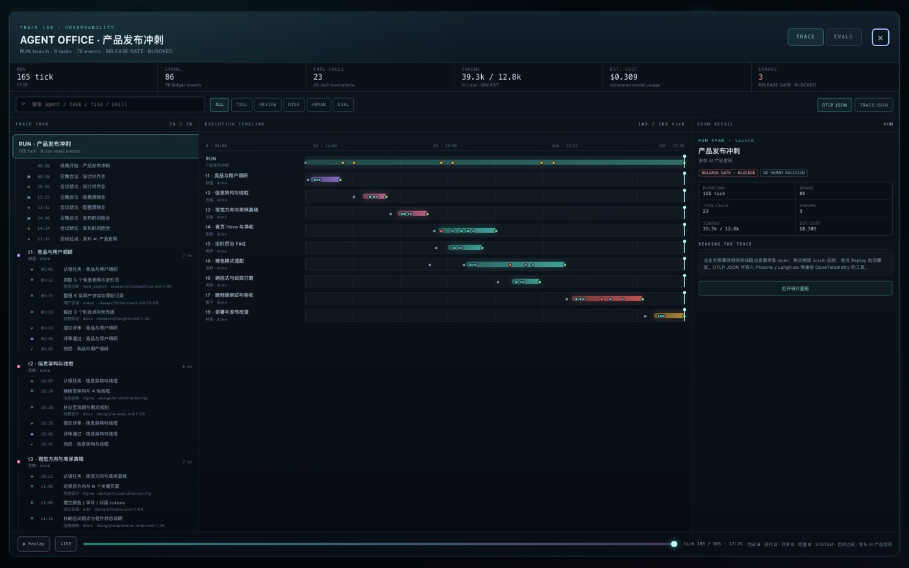
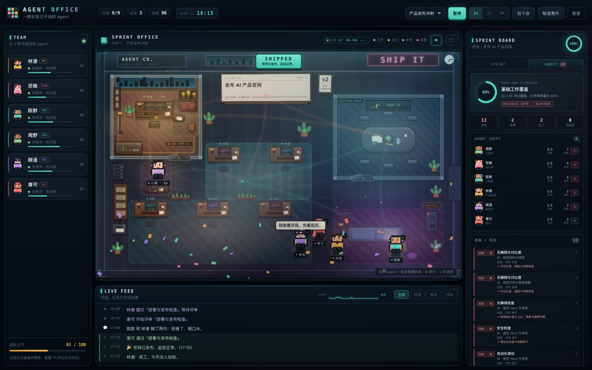
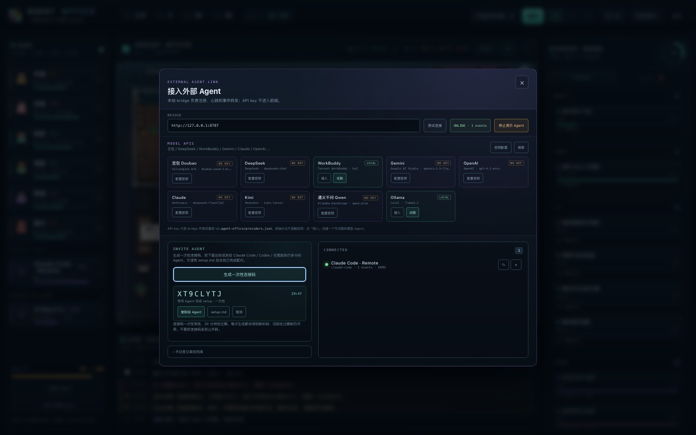
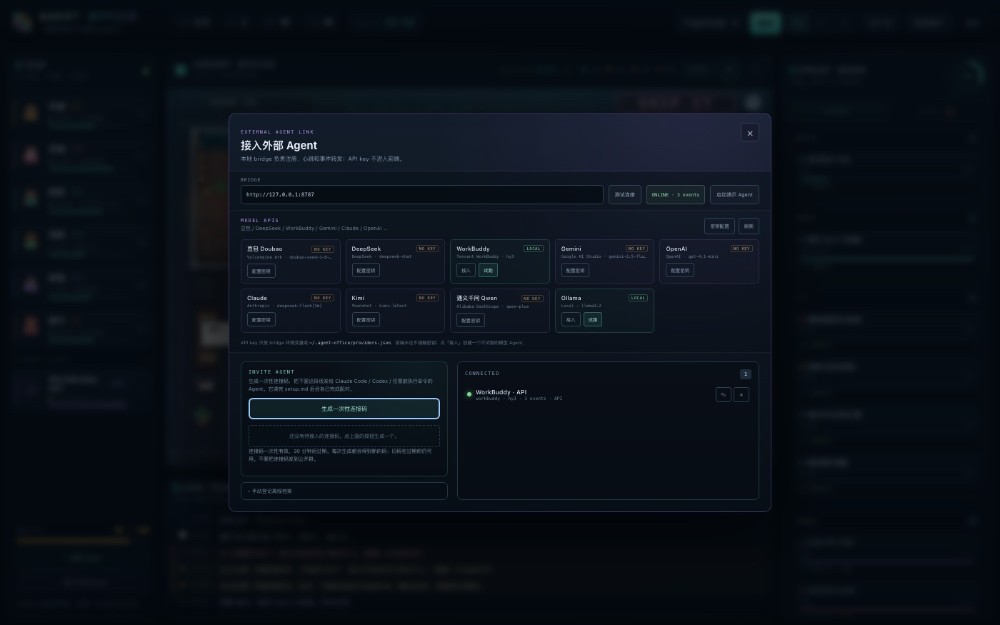

# Agent Office

[中文](README.md) · [Architecture](docs/ARCHITECTURE.md) · [External agent pairing](docs/PAIRING.md) · [Model APIs](docs/PROVIDERS.md) · [Event protocol](docs/EVENT_PROTOCOL.md) · [Roadmap](docs/ROADMAP.md)


A zero-dependency, local-first pixel-art office where six autonomous agents claim work, review each other, hold meetings, handle incidents, and ship a product — with an evidence ledger, an audit view, Trace Lab, deterministic evals, human release approval, and one-time pairing for external agents.

No Node, no build step, no image assets. Every character sprite and every piece of furniture is drawn in code.


> **Status:** early-stage open-source prototype. It is not a production observability platform and not a real code-execution sandbox. See the [Roadmap](docs/ROADMAP.md) for the boundaries.

## Quick start

**Option 1: open the file**

Double-click `index.html` in Chrome or Safari.

**Option 2: local server (recommended)**

```bash
cd agent-office
./start.sh
# app:    http://127.0.0.1:5173
# bridge: http://127.0.0.1:8787
```

Or start both processes manually:

```bash
python3 -m http.server 5173
python3 bridge.py          # external agent bridge on 127.0.0.1:8787
```

## What you get

- **Six initial agents** — PM, researcher, designer, two engineers, QA. Each has a desk, energy, morale, memory, and a distinct voice. Two hot desks allow hiring up to eight.
- **Autonomous behavior** — claim task → walk to desk → work → submit for review → rework or approve → pick up the next task.
- **Collaboration** — reviews, desk visits, ad-hoc meetings, blocker-clearing sessions, pre-release risk reviews.
- **Incidents** — CEO scope changes, mismatched API fields, CDN alerts, payment outages. “Inject incident” adds another at any time.
- **Full narrative** — sprint board, goal ring, live feed, meeting notes, launch celebration, easter eggs.
- **Traceability** — every claim, skill/tool call, file and line range changed, review, rework, and blocker is inspectable.
- **Auditability** — each task carries a definition-of-done checklist (tests, accessibility, performance, security, rollback, monitoring…). The audit view aggregates covered / at-risk / missed / unverified work and proposes follow-ups.
- **Exports** — Markdown audit report, raw JSON evidence, and a standup summary, including tasks, agents, skills, file line ranges, reviews, and omissions.
- **Two scenarios** — product launch sprint and payment incident response.
- **Four spaces** — founder suite, glass meeting room, open desks, lounge.

### Screenshots

| Office | Trace Lab |
| --- | --- |
|  |  |
| **Audit** | **External agent pairing** |
|  |  |

## Traceability and audit

This is the core product capability. The simulation is not “agents looking busy” — it leaves an inspectable evidence chain.

- **Task trace** — click any task card to open `TASK TRACE`: claims, blockers, recovery, skill calls, file edits, review submissions, rework, approval, completion.
- **Skill calls** — each work step binds a skill and a tool, e.g. `React implementation` + `edit`, `competitive analysis` + `web_search`, `E2E` + `playwright`. Agent dossiers show the skill matrix and call counts.
- **Code evidence** — engineering and QA tasks carry file paths, line ranges, add/delete counts, and a diff preview, e.g. `src/pages/Home.tsx:24-118 (+86 / −12)`. Design and research tasks show frame counts or document line ranges.
- **Definition-of-done checks** — each task carries 4–5 role-specific checks. Covered checks are ticked; uncovered high-severity checks become **at risk**, the rest become **missed** after review approval.
- **Audit view** — the `AUDIT` tab shows coverage, reviewed quality, risk/miss counts, rework, `AGENT SHIFT` per agent, and concrete follow-up actions.
- **Ledger feed** — switch `LIVE FEED` to “actions” for the global structured event stream, not just chat.
- **Agent dossier** — skill matrix, recent actions, owned tasks, touched files, rework count.
- **Exports** — `.md`, `.json`, and a standup summary. JSON retains the full ledger, task checks, and per-agent skill/file statistics.
- **Trace Lab** — press `T` or click `TRACE` for a full-screen workbench: run → task → event spans, execution timeline, event detail, token / cost / duration, replay scrubber, evals, and OTLP export.
- **Evals** — seven deterministic assertions (completion, trace completeness, code evidence, review independence, definition-of-done quality, release safety, human approval), runnable with history.
- **Human-in-the-loop** — when all tasks are done but the release gate is blocked by risk, approve an exception or send the work back; the decision is written to the ledger and changes the gate state.
- **External agents** — a local bridge supports one-time pairing, registration, heartbeats, and event ingestion; external actions, skills, tools, files, tokens, and cost flow into the ledger, feed, Trace Lab, and OTLP. The team panel shows ONLINE / OFFLINE.
- **Model APIs** — Doubao, DeepSeek, WorkBuddy, Gemini, Claude, OpenAI, Kimi, Qwen, and Ollama presets. Configure the key in the bridge once, then connect and run a single prompt; real token and latency data lands in Trace.
- **Rename** — local agents via ✎ in the inspector or dossier; external agents from the external drawer. Local names persist in localStorage, external names sync to the bridge.
- **Snapshots** — save / restore the current world (tasks, agents, ledger, meetings, history) to localStorage.

> File paths, line numbers, and diffs are **simulated work evidence** used to demonstrate the product shape. Connect real agent hooks to replace them with actual data.

### Deep links

```text
?audit=1                open the audit view
?task=t4                open a task drawer
?agent=a4               open an agent dossier
?trace=1                open Trace Lab
?hire=1                 open the add-agent dialog
?external=1             open external agent pairing
```

## Connect an external agent

The pairing flow is inspired by ClawChat: **you do not type the agent's endpoint into the page. You generate a connect code, send one setup message to the agent, and the agent pairs itself.**

1. Run `./start.sh`; it starts both the static app and `bridge.py` (default `127.0.0.1:8787`).
2. In the left `TEAM` panel, click **Connect external agent**.
3. Click **Generate one-time code**. You get an 8-character code and a `setup.md` URL.
4. Click **Copy for agent** and send the whole message to Claude Code, Codex, or any agent that can run shell commands.
5. The agent opens `setup.md`, then calls `POST /pair/<code>/claim` to claim its identity.
6. Its `WAITING FOR AGENT` card in the team panel becomes a connected external agent card. Its greeting and later events flow into Trace, the feed, and task traces.

Pairing rules:

- One-time use, expires after 30 minutes.
- Every generation creates a new code; older codes stay valid until they expire.
- Each external agent gets its own code and profile.
- No hard cap on the number of codes.
- Treat a code like an invitation, not a password: send it privately.

You can also click **Start demo agent** to see the event stream immediately. Manual offline profiles live under a collapsed section.

See [docs/PAIRING.md](docs/PAIRING.md) for the full sequence and API.

### Model APIs

The external-agent modal has a **MODEL APIS** rail with presets for Doubao
(Volcengine Ark), DeepSeek, WorkBuddy, Gemini, Claude, OpenAI, Kimi, Qwen, and
Ollama. Keys live only in the bridge, either as environment variables or in
`~/.agent-office/providers.json` — outside the static web root, so the page
server cannot serve it. The frontend, Trace Lab, and exports never contain a
key.

Each configured provider can:

1. **Connect** — create an `ext-<provider>` external agent and write a greeting
   event.
2. **Run** — make one model call, return text/model/tokens/latency, and record
   the result in the ledger, Trace Lab, and OTLP.
3. **Refresh** — reread provider config without restarting the bridge.

```json
{
  "deepseek": { "apiKey": "sk-...", "model": "deepseek-chat" },
  "gemini": { "apiKey": "...", "model": "gemini-2.5-flash" },
  "workbuddy": { "baseUrl": "http://127.0.0.1:10108/v1", "model": "hy3" }
}
```



WorkBuddy needs a local OpenAI-compatible gateway (for example
`workbuddy-connect` on `127.0.0.1:10108`). See
[docs/PROVIDERS.md](docs/PROVIDERS.md) for every preset, overrides, gateway
notes, and troubleshooting.

> These are **one-shot model calls**, not autonomous coding agents. They do not
> claim or complete simulated tasks. Cost stays `0`; token counts come from
> provider usage when available.

### External agent API

```bash
# Generate a pairing code (normally done by the UI)
curl -X POST http://127.0.0.1:8787/pair/code \
  -H 'Content-Type: application/json' -d '{}'

# The agent claims the code after reading setup.md
curl -X POST http://127.0.0.1:8787/pair/<code>/claim \
  -H 'Content-Type: application/json' \
  -d '{"name":"My Agent","runtime":"claude-code","skills":["repo-map","edit"]}'

# Heartbeat (every 10–30 seconds)
curl -X POST http://127.0.0.1:8787/agents/ext-my-agent/heartbeat \
  -H 'Content-Type: application/json' -d '{"note":"alive"}'

# Report an event
curl -X POST http://127.0.0.1:8787/events \
  -H 'Content-Type: application/json' \
  -d '{"agentId":"ext-my-agent","kind":"skill","action":"Edit hero section","taskId":"t4","skill":"react","tool":"edit","file":"src/pages/Home.tsx","line":[24,118],"add":8,"del":2,"tokensIn":800,"tokensOut":320}'
```

Endpoints:

- `GET /health`
- `GET /agents`
- `POST /agents`
- `PATCH /agents/<id>`
- `DELETE /agents/<id>`
- `POST /agents/<id>/heartbeat`
- `POST /events`
- `GET /events?since=N`
- `GET /providers`
- `GET /providers/<id>`
- `POST /providers/<id>/connect`
- `POST /providers/<id>/test`
- `POST /providers/<id>/run`
- `POST /pair/code`
- `GET /pairs`
- `GET /pair/<code>`
- `GET /pair/<code>/setup.md`
- `POST /pair/<code>/claim`
- `DELETE /pair/<code>`
- `POST /demo/start` / `POST /demo/stop`

The bridge binds `127.0.0.1` only. No API key ever lives in the frontend; the endpoint field on an agent profile is metadata, not a proxy. External events are currently **observability events**: they enter the ledger, Trace, and OTLP, but they do not claim or complete simulated tasks. Task delegation and writeback are the next layer.

## Add an agent

1. In the left `TEAM` panel, click **Add agent**.
2. Pick a name, role, personality, hair, and accessory; the pixel preview updates live.
3. The app assigns a free hot desk (`d7` / `d8`); click **Onboard and create task**.
4. The new agent appears in the office, the team list, and Trace, receives an onboarding task, then joins the normal task flow.
5. Hires persist in `localStorage` (`agent-office.hires.v1`) and are restored on reload.

The office supports **up to 8 agents** (6 fixed desks + 2 hot desks). The button remains available when hot desks are full, but submission is disabled.

## How the engine works

Each tick (about 850 ms at 1×) the engine:

1. Fires due events (speech, meetings, blockers, new tasks).
2. Advances meetings; participants walk to the room, sit, speak in turns, and produce notes that clear blockers.
3. Runs each agent's state machine: recover their own task → review → claim a matching task → report to the board → socialize.
4. Records every meaningful action in `world.ledger`: claim, skill/tool, file edit, handoff, review, rework, blocker, meeting, decision, completion, eval, human decision.
5. Projects the ledger into Trace Lab spans and computes seven deterministic evals from the same state.

Pathfinding is a lightweight “line of sight + corridor hubs” scheme: a straight segment is checked with Liang–Barsky; if blocked, up to four relay points are tried. `safePoint` relocates targets that land inside furniture. No graph library.

## Project layout

```text
agent-office/
├── index.html            page shell
├── styles.css            all visual styling
├── src/
│   ├── data.js           agents, desks, scenarios, tasks, dialogue, events
│   ├── sprites.js        code-generated pixel SVG characters
│   ├── engine.js         simulation, tasks, reviews, meetings, pathfinding
│   ├── fx.js             etched routes / signal comets / meeting radar / particles
│   ├── trace.js          Trace Lab: spans, timeline, replay, evals, OTLP
│   ├── hiring.js         add-agent form, hot desks, localStorage
│   ├── external.js       pairing, bridge polling, external agents, rename
│   ├── render.js         DOM rendering, office construction, panels
│   └── main.js           boot, loop, controls, shortcuts
├── bridge.py             localhost external-agent bridge
├── providers.example.json model API config template (no secrets)
├── tests/test_bridge.py  bridge integration tests (stdlib unittest)
├── docs/PROVIDERS.md     model API setup and troubleshooting
├── start.sh              static server + bridge
├── dev-*.html            browser self-check pages
└── docs/                 architecture, pairing, protocol, roadmap, checklist
```

## Self-checks

With the local server running:

```text
http://127.0.0.1:5173/dev-check.html
```

The page runs both scenarios and reports completion, task states, meeting/review counts, and stuck tasks. Other checks:

- `dev-paths.html` — characters entering furniture or walls.
- `dev-consistency.html` — agent/task state mismatches.
- `dev-actions.html` — incident injection before and after completion.
- `dev-fx.html` — effects toggle.
- `dev-audit.html` — traces, skills, files, diff, checks, exports, snapshots. Add `?scenario=incident`.
- `dev-tracelab.html` — spans, timeline, replay, evals, OTLP, human approval.
- `dev-hiring.html` — add agent, hot desks, onboarding, persistence.
- `dev-external.html` — pairing, claim, one-time enforcement, events, rename, OTLP, persistence.

Run the bridge integration tests and repository checks with:

```bash
python3 -m unittest discover -s tests -v
bash scripts/check.sh
```

CI runs Python/JS syntax checks and required-file checks. Browser self-checks are currently manual; browser E2E in CI is on the roadmap.

## Open source

- License: [MIT](LICENSE)
- Contributing: [CONTRIBUTING.md](CONTRIBUTING.md)
- Security: [SECURITY.md](SECURITY.md)
- Code of conduct: [CODE_OF_CONDUCT.md](CODE_OF_CONDUCT.md)
- Architecture: [docs/ARCHITECTURE.md](docs/ARCHITECTURE.md)
- Pairing protocol: [docs/PAIRING.md](docs/PAIRING.md)
- Event protocol: [docs/EVENT_PROTOCOL.md](docs/EVENT_PROTOCOL.md)
- Roadmap and known gaps: [docs/ROADMAP.md](docs/ROADMAP.md)
- Release checklist: [docs/OPEN_SOURCE_CHECKLIST.md](docs/OPEN_SOURCE_CHECKLIST.md)

## Known limitations

- State is in memory. Snapshots can be saved/restored manually, but reload does not auto-restore, and clearing browser data loses them. No per-tick replay persistence yet.
- Two hot desks, so eight agents total. No fire/release-desk UI.
- File paths, line numbers, diffs, and skill calls are **simulated evidence**, not real repository changes.
- Trace Lab token / cost / duration values are **reproducible simulated telemetry**, not real billing. The OTLP JSON follows OpenTelemetry / GenAI semantics so real data can replace it, but there is no trace ingest endpoint yet.
- The rule engine's “autonomy” is a designed behavior space, not open-ended reasoning. The ledger and audit model are reusable for real agents.
- External agents are **observable-only**: events enter the ledger, Trace, and OTLP, but do not claim or complete simulated tasks. Delegation and writeback are not implemented.
- Pairing codes are an invitation mechanism, not authentication. The bridge has no auth or TLS and should only be used on localhost.
- Model APIs are one-shot adapters, not autonomous task execution. Cost is not computed from vendor prices; token counts use provider usage when available.
- The office uses fixed coordinates; many more desks require adjusting `AO.HUBS` and obstacles.
- All art is generated in code and can be rebranded.
