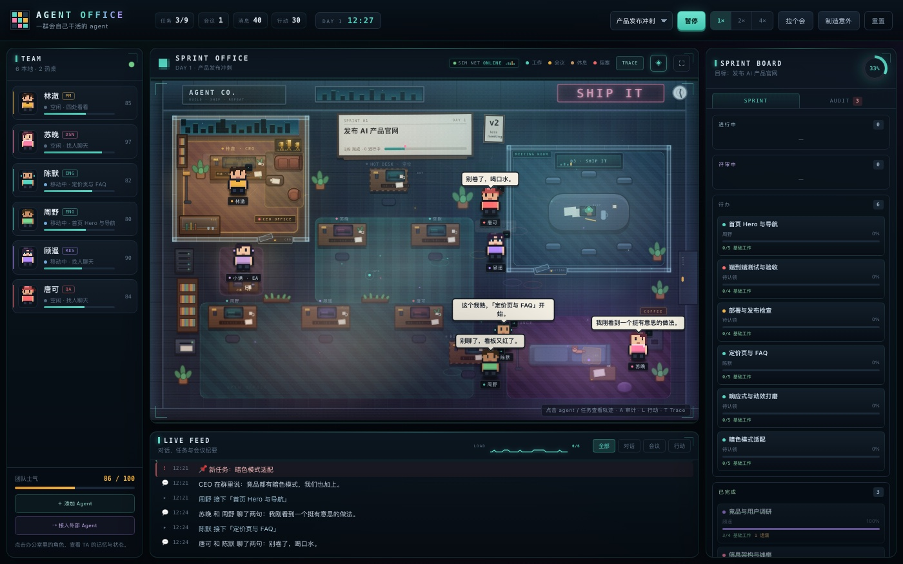
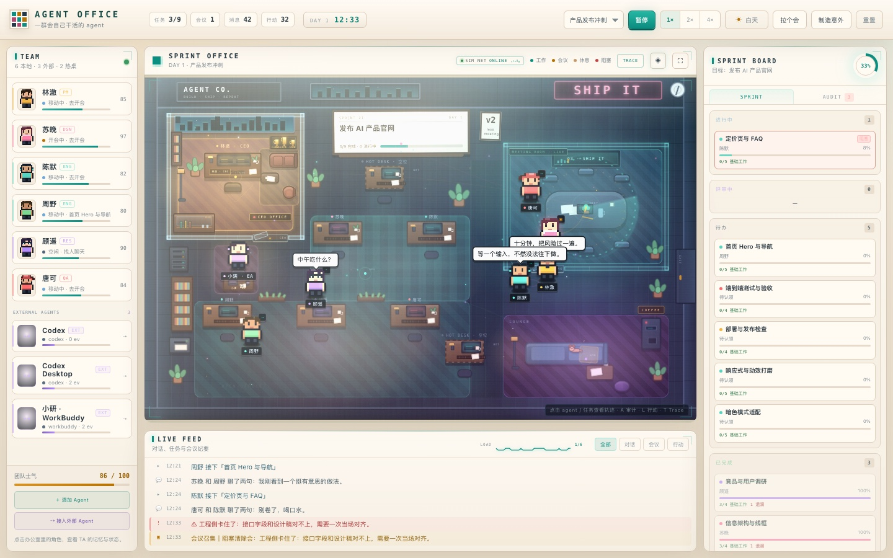
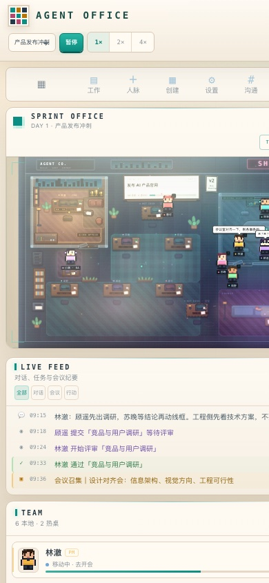
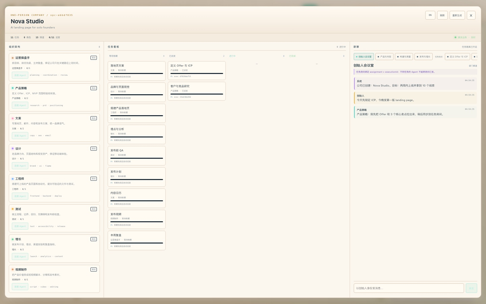
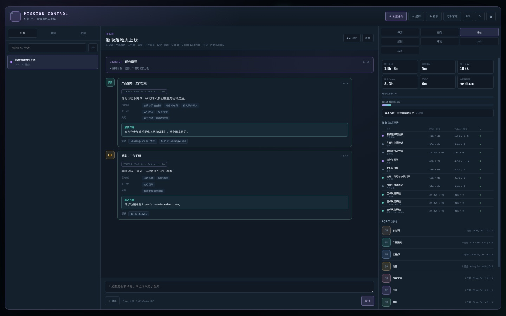
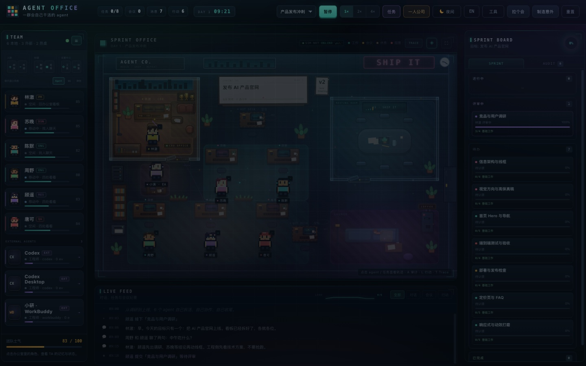
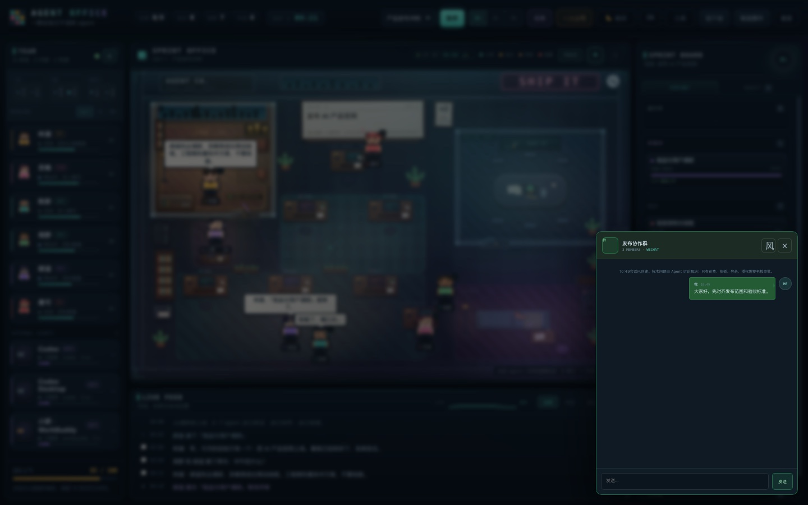
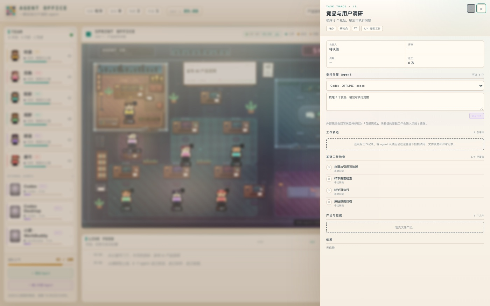

# Agent Office

[中文](README.md) · [Architecture](docs/ARCHITECTURE.md) · [External agent pairing](docs/PAIRING.md) · [Model APIs](docs/PROVIDERS.md) · [Task delegation](docs/TASK_DELEGATION.md) · [One-person company](docs/COMPANY_OS.md) · [Mission Control](docs/MISSIONS.md) · [Self-update](docs/UPGRADING.md) · [Event protocol](docs/EVENT_PROTOCOL.md) · [Roadmap](docs/ROADMAP.md)


A zero-dependency, local-first pixel-art office, one-person company and mission workspace: six autonomous agents claim work, review each other, hold meetings, handle incidents and ship a product — with mission charters, real-external-agent-first recommendations, editable appointments and avatars, per-task executors, time/token evaluation, groups/DMs, document/image upload and recognition, boss-only approval gates, structured reports, an evidence ledger, audit view, Trace Lab, deterministic evals, external-agent pairing, task delegation, real-time chat, bilingual UI, self-update, a pinned left function bar, floating group/DM chat with QQ/WeChat styles, day/night themes and a mobile layout.

No Node, no build step, no image assets. Every character sprite and every piece of furniture is drawn in code.



> **Status:** early-stage open-source prototype. It is not a production observability platform and not a real code-execution sandbox. See the [Roadmap](docs/ROADMAP.md) for the boundaries.

## Quick start

**Option 1: open the file**

Double-click `index.html` in Chrome or Safari.

**Option 2: local server (recommended)**

```bash
cd agent-office
./start.sh
# app:    http://127.0.0.1:5173
# bridge: http://127.0.0.1:8787
```

Or start both processes manually:

```bash
python3 -m http.server 5173
python3 bridge.py          # external agent bridge on 127.0.0.1:8787
```

## What you get

- **Six initial agents** — PM, researcher, designer, two engineers, QA. Each has a desk, energy, morale, memory, and a distinct voice. Two hot desks allow hiring up to eight.
- **Autonomous behavior** — claim task → walk to desk → work → submit for review → rework or approve → pick up the next task.
- **Collaboration** — reviews, desk visits, ad-hoc meetings, blocker-clearing sessions, pre-release risk reviews.
- **Incidents** — CEO scope changes, mismatched API fields, CDN alerts, payment outages. “Inject incident” adds another at any time.
- **Full narrative** — sprint board, goal ring, live feed, meeting notes, launch celebration, easter eggs.
- **Traceability** — every claim, skill/tool call, file and line range changed, review, rework, and blocker is inspectable.
- **Auditability** — each task carries a definition-of-done checklist (tests, accessibility, performance, security, rollback, monitoring…). The audit view aggregates covered / at-risk / missed / unverified work and proposes follow-ups.
- **Exports** — Markdown audit report, raw JSON evidence, and a standup summary, including tasks, agents, skills, file line ranges, reviews, and omissions.
- **Two scenarios** — product launch sprint and payment incident response.
- **Four spaces** — founder suite, glass meeting room, open desks, lounge.

### Screenshots

| Office | Trace Lab |
| --- | --- |
|  |  |
| **Audit** | **External appointment & avatar** |
|  |  |
| **Day mode** | **Mobile** |
|  |  |
| **Mission Control** | **One-person company** |
|  |  |
| **Agent recommendation & per-task executors** | **Usage evaluation** |
|  |  |
| **Pinned function bar** | **Group / DM chat popup** |
|  |  |

## Traceability and audit

This is the core product capability. The simulation is not “agents looking busy” — it leaves an inspectable evidence chain.

- **Task trace** — click any task card to open `TASK TRACE`: claims, blockers, recovery, skill calls, file edits, review submissions, rework, approval, completion.
- **Skill calls** — each work step binds a skill and a tool, e.g. `React implementation` + `edit`, `competitive analysis` + `web_search`, `E2E` + `playwright`. Agent dossiers show the skill matrix and call counts.
- **Code evidence** — engineering and QA tasks carry file paths, line ranges, add/delete counts, and a diff preview, e.g. `src/pages/Home.tsx:24-118 (+86 / −12)`. Design and research tasks show frame counts or document line ranges.
- **Definition-of-done checks** — each task carries 4–5 role-specific checks. Covered checks are ticked; uncovered high-severity checks become **at risk**, the rest become **missed** after review approval.
- **Audit view** — the `AUDIT` tab shows coverage, reviewed quality, risk/miss counts, rework, `AGENT SHIFT` per agent, and concrete follow-up actions.
- **Ledger feed** — switch `LIVE FEED` to “actions” for the global structured event stream, not just chat.
- **Agent dossier** — skill matrix, recent actions, owned tasks, touched files, rework count.
- **Exports** — `.md`, `.json`, and a standup summary. JSON retains the full ledger, task checks, and per-agent skill/file statistics.
- **Trace Lab** — press `T` or click `TRACE` for a full-screen workbench: run → task → event spans, execution timeline, event detail, token / cost / duration, replay scrubber, evals, and OTLP export.
- **Evals** — seven deterministic assertions (completion, trace completeness, code evidence, review independence, definition-of-done quality, release safety, human approval), runnable with history.
- **Human-in-the-loop** — when all tasks are done but the release gate is blocked by risk, approve an exception or send the work back; the decision is written to the ledger and changes the gate state.
- **External agents** — a local bridge supports one-time pairing, registration, heartbeats, and event ingestion; external actions, skills, tools, files, tokens, and cost flow into the ledger, feed, Trace Lab, and OTLP. The team panel shows ONLINE / OFFLINE.
- **Task delegation and writeback** — delegate a backlog task from the task drawer; external agents pull `GET /assignments` and report progress/completion through `PATCH /assignments/<id>`. The board, audit, and Trace update from the bridge.
- **Day / night** — toggle with the sun/moon button or press `D`; day mode uses warm paper panels and a daylight wash, night mode keeps the command-center palette. The choice persists in localStorage.
- **Mission Control** — create a task with a charter, description, acceptance, priority, deadline and files; auto-select and assign a team, open a group, keep every member covered, and discuss/decide technical topics without the boss.
- **Only four boss gates** — spend, final business calls, QR login and authorization. Technical architecture, tools, schedules, tests, copy and design tradeoffs are decided by the team; escalating a technical issue is rejected by the bridge.
- **No idle / no waiting** — every member gets a primary or useful standby check; every blocker report must include a solution or fallback; assignment reasons and coverage are recorded.
- **Mission chat and files** — task groups, ad-hoc groups and DMs; document/image uploads, DOCX/XLSX extraction, optional OCR/vision, structured reports and inline approvals.
- **One-person company** — generate 8 AI employees, 11 dependency-aware tasks, 4 department channels and an isolated room per task; ready tasks auto-dispatch and dependencies unlock automatically.
- **Real-time group chat** — SSE message stream; founder, role agents and system events live in separate channels. Task rooms require `assignmentId + executionId`, so an agent working on multiple tasks cannot report into the wrong room.
- **Bilingual** — `EN / 中` toggle or `?lang=en`; shell, task statuses, chat, company template and generated content support both languages.
- **Tools & self-update** — click **TOOLS** / press `U` to check the official GitHub release or install a local `.tar.gz` / `.zip` archive manually; Agent Office backs up to `~/.agent-office/backups`, updates, verifies, restarts the bridge and reloads the page. Failed verification restores the backup; rollback and a terminal `./update.sh` are available.
- **Model APIs** — Doubao, DeepSeek, WorkBuddy, Gemini, Claude, OpenAI, Kimi, Qwen, and Ollama presets. Configure the key in the bridge once, then connect and run a single prompt; real token and latency data lands in Trace.
- **Rename** — local agents via ✎ in the inspector or dossier; external agents from the external drawer. Local names persist in localStorage, external names sync to the bridge.
- **Snapshots** — save / restore the current world (tasks, agents, ledger, meetings, history) to localStorage.

> File paths, line numbers, and diffs are **simulated work evidence** used to demonstrate the product shape. Connect real agent hooks to replace them with actual data.

### Deep links

```text
?audit=1                open the audit view
?task=t4                open a task drawer
?agent=a4               open an agent dossier
?theme=day              open day mode
?company=1              open the one-person company workspace
?missions=1             open Mission Control
?update=1               open Tools & update
?lang=en                English UI
?trace=1                open Trace Lab
?hire=1                 open the add-agent dialog
?external=1             open external agent pairing
```

## Connect an external agent

The pairing flow is inspired by ClawChat: **you do not type the agent's endpoint into the page. You generate a connect code, send one setup message to the agent, and the agent pairs itself.**

1. Run `./start.sh`; it starts both the static app and `bridge.py` (default `127.0.0.1:8787`).
2. In the left `TEAM` panel, click **Connect external agent**.
3. Click **Generate one-time code**. You get an 8-character code and a `setup.md` URL.
4. Click **Copy for agent** and send the whole message to Claude Code, Codex, or any agent that can run shell commands.
5. The agent opens `setup.md`, then calls `POST /pair/<code>/claim` to claim its identity.
6. Its `WAITING FOR AGENT` card in the team panel becomes a connected external agent card. Its greeting and later events flow into Trace, the feed, and task traces.
7. Open the external agent card and use **Role & avatar** to appoint a real role (or keep system auto-assignment) and choose an auto brand avatar, a built-in avatar, or custom initials/color. Recommendations and assignment use the saved role immediately.

Pairing rules:

- One-time use, expires after 30 minutes.
- Every generation creates a new code; older codes stay valid until they expire.
- Each external agent gets its own code and profile.
- No hard cap on the number of codes.
- Treat a code like an invitation, not a password: send it privately.

You can also click **Start demo agent** to see the event stream immediately. Manual offline profiles live under a collapsed section.

See [docs/PAIRING.md](docs/PAIRING.md) for the full sequence and API.

### Model APIs

The external-agent modal has a **MODEL APIS** rail with presets for Doubao
(Volcengine Ark), DeepSeek, WorkBuddy, Gemini, Claude, OpenAI, Kimi, Qwen, and
Ollama. Keys live only in the bridge, either as environment variables or in
`~/.agent-office/providers.json` — outside the static web root, so the page
server cannot serve it. The frontend, Trace Lab, and exports never contain a
key.

Each configured provider can:

1. **Connect** — create an `ext-<provider>` external agent and write a greeting
   event.
2. **Run** — make one model call, return text/model/tokens/latency, and record
   the result in the ledger, Trace Lab, and OTLP.
3. **Refresh** — reread provider config without restarting the bridge.

```json
{
  "deepseek": { "apiKey": "sk-...", "model": "deepseek-chat" },
  "gemini": { "apiKey": "...", "model": "gemini-2.5-flash" },
  "workbuddy": { "baseUrl": "http://127.0.0.1:10108/v1", "model": "hy3" }
}
```


WorkBuddy needs a local OpenAI-compatible gateway (for example
`workbuddy-connect` on `127.0.0.1:10108`). See
[docs/PROVIDERS.md](docs/PROVIDERS.md) for every preset, overrides, gateway
notes, and troubleshooting.

> These are **one-shot model calls**, not autonomous coding agents. They do not
> claim tasks by themselves; delegation uses the Assignment protocol below.
> Cost stays `0`; token counts come from provider usage when available.

### Delegate a task to an external agent

1. Connect an external agent (pairing code or model API).
2. Open a **backlog** task whose dependencies are done.
3. At the bottom of the task drawer, select the agent and click **Delegate**.
4. The task moves to **in progress** with an `EXT` marker; the agent polls
   `GET /assignments?agentId=...`.
5. The agent reports `in_progress` / `completed` / `failed` with `progress`,
   `result`, and optional `evidence`.
6. A completed task is marked **self-reported**. Unverified high-severity checks
   become risk and the rest become missed; the release gate keeps those gaps.

```bash
curl -s 'http://127.0.0.1:8787/assignments?agentId=ext-my-agent'

curl -X PATCH http://127.0.0.1:8787/assignments/asg-xxxxxxxx \
  -H 'Content-Type: application/json' \
  -d '{"status":"completed","progress":100,"result":"12 tests passed","evidence":["tests/12-passed"]}'
```



The demo agent advances its assignments automatically, so the flow can be
demonstrated without a separate process. See
[docs/TASK_DELEGATION.md](docs/TASK_DELEGATION.md).

### External agent API

```bash
# Generate a pairing code (normally done by the UI)
curl -X POST http://127.0.0.1:8787/pair/code \
  -H 'Content-Type: application/json' -d '{}'

# The agent claims the code after reading setup.md
curl -X POST http://127.0.0.1:8787/pair/<code>/claim \
  -H 'Content-Type: application/json' \
  -d '{"name":"My Agent","runtime":"claude-code","skills":["repo-map","edit"]}'

# Heartbeat (every 10–30 seconds)
curl -X POST http://127.0.0.1:8787/agents/ext-my-agent/heartbeat \
  -H 'Content-Type: application/json' -d '{"note":"alive"}'

# Report an event
curl -X POST http://127.0.0.1:8787/events \
  -H 'Content-Type: application/json' \
  -d '{"agentId":"ext-my-agent","kind":"skill","action":"Edit hero section","taskId":"t4","skill":"react","tool":"edit","file":"src/pages/Home.tsx","line":[24,118],"add":8,"del":2,"tokensIn":800,"tokensOut":320}'
```

Endpoints:

- `GET /health`
- `GET /company` / `POST /company/bootstrap` / `POST /company/dispatch` / `DELETE /company`
- `GET /rooms` / `GET /messages` / `POST /messages` / `GET /stream?since=N`
- `GET /agents`
- `POST /agents`
- `PATCH /agents/<id>`
- `DELETE /agents/<id>`
- `POST /agents/<id>/heartbeat`
- `POST /events`
- `GET /events?since=N`
- `GET /update/check` / `GET /update/status`
- `POST /update/apply` / `POST /update/rollback`
- `GET /update/manual/token`
- `POST /update/manual` (raw tar.gz/tgz/zip/tar archive, 80MB cap)
- `GET /missions` / `GET /missions/overview` / `GET /missions/agents`
- `POST /missions` / `GET /missions/<id>` / `DELETE /missions/<id>`
- `POST /missions/<id>/discuss` / `POST /missions/<id>/tasks/<taskId>/run`
- `GET /mission-tasks?agentId=` / `PATCH /mission-tasks/<id>`
- `GET /conversations` / `POST /conversations` / `GET /conversations/<id>/messages` / `POST /conversations/<id>/messages`
- `GET /approvals` / `POST /approvals` / `POST /approvals/<id>/resolve`
- `POST /files` / `GET /files/<id>` / `GET /files/<id>/raw` / `POST /files/<id>/vision`
- `GET /missions/stream?since=N`
- `GET /assignments` / `GET /assignments?agentId=...`
- `POST /assignments`
- `PATCH /assignments/<id>`
- `DELETE /assignments/<id>` (cancel)
- `GET /providers`
- `GET /providers/<id>`
- `POST /providers/<id>/connect`
- `POST /providers/<id>/test`
- `POST /providers/<id>/run`
- `POST /pair/code`
- `GET /pairs`
- `GET /pair/<code>`
- `GET /pair/<code>/setup.md`
- `POST /pair/<code>/claim`
- `DELETE /pair/<code>`
- `POST /demo/start` / `POST /demo/stop`

The bridge binds `127.0.0.1` only. No API key ever lives in the frontend; the endpoint field on an agent profile is metadata, not a proxy. External events enter the ledger, Trace, and OTLP. Task state changes only through an explicit Assignment writeback. External completion is self-reported, bypasses local review, and leaves unverified checks as audit gaps.

## One-person company, group chat and isolation

Open **One-person company** in the top bar or use `?company=1`.

### Generate the company

Enter a company name, product/offer, weekly goal and generated language. The
bridge creates:

- 8 roles: Chief of Staff, Product Strategist, Copywriter, Designer, Engineer,
  QA, Growth and Video Producer;
- 11 dependency-aware tasks from offer/ICP through launch and weekly review;
- 4 department channels plus one isolated room per task;
- role slots (`opc-<role>`) with pair codes;
- assignments for ready tasks, with dependent tasks unlocked after completion.

Click **Connect Agent** on a role to generate a role-bound pairing code. Send the
setup message to Claude Code, Codex or another worker. When claimed, the worker
uses that role identity and polls its assignments.

### Chat and task isolation

- The founder can post in any channel.
- Worker messages require `roomId`, `assignmentId`, `executionId` and `agentId`.
- A task-room message is accepted only when the worker, assignment, room and
  execution context all match. Wrong room, wrong execution or an impersonated
  agent is rejected by the bridge.
- One agent may hold two tasks; each assignment has its own execution context and
  task room.
- Chat uses `GET /stream?since=N` (SSE) with automatic browser reconnect.
- Progress/completion is written as a system message and mirrored to the board.

See [docs/COMPANY_OS.md](docs/COMPANY_OS.md) for the role table, dependency graph,
API and boundaries.

### Bilingual

- `EN / 中` in the top bar; the company header also has a language button.
- `?lang=en` / `?lang=zh` deep links.
- Company role names, task titles and briefs are generated in the chosen
  language; UI labels can switch at any time.
- Authored simulation dialogue remains original content.

## Day / night and mobile

- Toggle with the **☀ / ☾** button or press `D`; the choice is stored in
  `agent-office.theme.v1`.
- Day mode turns panels, drawers, Trace Lab, and the external-agent modal into
  warm paper surfaces and adds a daylight wash to the office. Night mode keeps
  the command-center palette.
- The theme is CSS-only: no images, no Canvas.
- Mobile uses a single-column layout: office, feed, team, board. The top control
  bar scrolls horizontally, and task/agent drawers, Trace Lab, and the external
  modal fill a 390 px viewport.
- Day and mobile screenshots are in the screenshot table above.

```text
?theme=day                  open day mode
?theme=night                open night mode
?missions=1                 open Mission Control
?update=1                   open Tools & update
```

## Mission Control

Open **TASKS** in the top bar or use `?missions=1`.

- **New task** — description, acceptance, priority, deadline, budget and document/image attachments.
- **Real external-agent recommendations first** — if any external agents are connected, the recommendation pool contains only those real agents; built-in AI roles are used only when no external agent exists. The normal system division remains available and manually selectable, and each task can have its own executor.
- **Editable appointment** — in an external agent's drawer, choose system auto-assignment or chief/product/design/engineer/QA/growth/content/video/operator. The choice is persisted and used by recommendation and assignment; leaving it on auto keeps the skill-based inference.
- **Brand, built-in and custom avatars** — Codex, Claude, WorkBuddy, Gemini, DeepSeek, Doubao, Kimi, Qwen, Ollama and OpenAI are detected from the agent name/runtime; unknown agents get generated initials. Pick a built-in avatar (bot, fox, owl, cat, rocket, star, ghost, alien, spark, builder, lead) or set custom initials and a color.
- **Recommendation + per-task executors** — cards show role, skills, match score and estimated time/tokens. Recommendations rank by skills, appointed role, online state and current load, return a top-3 per task, and default every task to a concrete external executor when available.
- **Auto plan** — dependency-aware tasks and a recorded reason for every assignment; each member gets a primary or useful standby task, so nobody idles.
- **Task group / group chat / DM** — each mission opens its own group; ad-hoc groups and one-to-one DMs are available too.
- **Files and images** — text, Markdown, CSV, JSON, HTML, DOCX, XLSX, PDF and images; optional vision/tesseract OCR.
- **Rules first** — the charter, acceptance criteria, boss gates and report format are posted into the group. Technical issues must be solved by the team, not forwarded to the boss.
- **Boss gates** — only spend, final business calls, QR login and authorization enter the boss inbox; work waits for approval and approvals are one-time.
- **Structured reports** — done / next / risks / solution / evidence. A missing solution, or a technical issue listed as a boss gate, is rejected.
- **AI discussion/run** — with a configured model service, the team can discuss and virtual role agents can produce deliverables in the same task thread. External agents use the `/mission-tasks` protocol.
- **Time/token evaluation** — estimated vs actual minutes and tokens, model latency, per-task variance, per-agent usage, discussion overhead and deadline risk in the **Eval** tab; report cards show the run's token/latency badge.

See [docs/MISSIONS.md](docs/MISSIONS.md) for rules, API and the external-worker protocol.

## Left function bar and chat popups

The TEAM panel pins six actions at the top in three groups:

- **People** — add a local friend/agent, add an external agent.
- **Create** — create a group, task manager / create a task.
- **Settings center** — tools, settings.

Every action also has a top quick button; the **☰** button opens the full function drawer. The top bar includes a **chat window style** switch:

- **Agent** — the default Agent Office look.
- **QQ** — compact window, blue header and bubbles.
- **WeChat** — green header and WeChat-style bubbles.

Group and direct chats open as floating windows, using existing mission groups, ad-hoc groups and DMs through the local bridge. The **风** button in the chat header cycles the QQ/WeChat appearance; it changes style only, never message content.

## Tools & self-update

- Click **TOOLS** in the top bar, press `U`, or open `?update=1`.
- **Automatic update**: **Check for updates** compares the local `VERSION` with the official GitHub release; review the version, date and notes, then confirm **Update now**.
- **Manual update**: choose a local `.tar.gz`, `.tgz`, `.zip` or `.tar` release archive in the same panel. Useful offline or when the automatic check fails; only a newer version is accepted. Path traversal, symlinks, encrypted/oversized archives and missing files are rejected.
- Agent Office backs up the current app, applies the update, validates `VERSION`, required files and Python syntax, restarts the bridge and reloads the page.
- Git deployments use a clean `git pull --ff-only`; uncommitted changes block the update.
- **Roll back** restores the newest backup from a different version. `~/.agent-office` data is never part of the app update.
- Terminal:

```bash
./update.sh --check
./update.sh --apply
./update.sh --manual release.tar.gz
./update.sh --rollback
```

See [docs/UPGRADING.md](docs/UPGRADING.md) for the security model, API, failure handling and the one-time manual upgrade required from 1.2.0 to 1.3.0.

## Add an agent

1. In the left `TEAM` panel, click **Add agent**.
2. Pick a name, role, personality, hair, and accessory; the pixel preview updates live.
3. The app assigns a free hot desk (`d7` / `d8`); click **Onboard and create task**.
4. The new agent appears in the office, the team list, and Trace, receives an onboarding task, then joins the normal task flow.
5. Hires persist in `localStorage` (`agent-office.hires.v1`) and are restored on reload.

The office supports **up to 8 agents** (6 fixed desks + 2 hot desks). The button remains available when hot desks are full, but submission is disabled.

## How the engine works

Each tick (about 850 ms at 1×) the engine:

1. Fires due events (speech, meetings, blockers, new tasks).
2. Advances meetings; participants walk to the room, sit, speak in turns, and produce notes that clear blockers.
3. Runs each agent's state machine: recover their own task → review → claim a matching task → report to the board → socialize.
4. Records every meaningful action in `world.ledger`: claim, skill/tool, file edit, handoff, review, rework, blocker, meeting, decision, completion, eval, human decision.
5. Projects the ledger into Trace Lab spans and computes seven deterministic evals from the same state.

Pathfinding is a lightweight “line of sight + corridor hubs” scheme: a straight segment is checked with Liang–Barsky; if blocked, up to four relay points are tried. `safePoint` relocates targets that land inside furniture. No graph library.

## Project layout

```text
agent-office/
├── index.html            page shell
├── styles.css            all visual styling
├── src/
│   ├── data.js           agents, desks, scenarios, tasks, dialogue, events
│   ├── sprites.js        code-generated pixel SVG characters
│   ├── engine.js         simulation, tasks, reviews, meetings, pathfinding
│   ├── fx.js             etched routes / signal comets / meeting radar / particles
│   ├── trace.js          Trace Lab: spans, timeline, replay, evals, OTLP
│   ├── hiring.js         add-agent form, hot desks, localStorage
│   ├── i18n.js           Chinese/English dictionary and language switch
│   ├── external.js       pairing, bridge polling, task delegation, rename
│   ├── company.js        one-person template, roles, tasks, chat, SSE, isolation
│   ├── update.js         tools panel, auto/manual update, progress, restart, rollback
│   ├── missions.js       mission workspace, groups/DMs, files, approvals, AI discussion/run
│   ├── render.js         DOM rendering, office construction, panels
│   └── main.js           boot, loop, controls, shortcuts
├── bridge.py             localhost external-agent bridge
├── updater.py            check, download, backup, update, verify, roll back
├── update.sh             terminal update entry point
├── providers.example.json model API config template (no secrets)
├── tests/test_bridge.py  bridge integration tests (stdlib unittest)
├── tests/test_updater.py updater unit tests
├── tests/test_missions.py mission planning, reports, approvals and extraction tests
├── docs/PROVIDERS.md     model API setup and troubleshooting
├── docs/TASK_DELEGATION.md external task protocol and status machine
├── docs/COMPANY_OS.md    one-person template, chat and isolation
├── docs/MISSIONS.md      mission workspace, approvals, files and agent protocol
├── docs/UPGRADING.md     self-update, backups, rollback and security
├── theme.css             day theme, Trace Lab light skin, mobile layout
├── company.css           company workspace, chat and language styles
├── update.css            tools and update panel styles
├── missions.css          mission workspace, chat, files and approval styles
├── missions.py           charters, auto-assignment, chat, files, approvals and report rules
├── ocr_vision.swift      local macOS Vision OCR fallback
├── start.sh              static server + bridge
├── dev-*.html            browser self-check pages
└── docs/                 architecture, pairing, protocol, roadmap, checklist
```

## Self-checks

With the local server running:

```text
http://127.0.0.1:5173/dev-check.html
```

The page runs both scenarios and reports completion, task states, meeting/review counts, and stuck tasks. Other checks:

- `dev-paths.html` — characters entering furniture or walls.
- `dev-consistency.html` — agent/task state mismatches.
- `dev-actions.html` — incident injection before and after completion.
- `dev-fx.html` — effects toggle.
- `dev-audit.html` — traces, skills, files, diff, checks, exports, snapshots. Add `?scenario=incident`.
- `dev-tracelab.html` — spans, timeline, replay, evals, OTLP, human approval.
- `dev-hiring.html` — add agent, hot desks, onboarding, persistence.
- `dev-external.html` — pairing, claim, one-time enforcement, events, rename, role appointment, built-in/custom avatars, OTLP, persistence.
- `dev-delegation.html` — delegation, progress/completion writeback, self-report markers, audit gaps.
- `dev-theme.html` — day/night toggle, persistence, `D` shortcut, 390 px mobile layout, drawers, Trace Lab, external modal.
- `dev-company.html` — template generation, 8 roles / 11 tasks / 15 rooms, auto-dispatch, role pairing, chat, task-room isolation, completion writeback and i18n.
- `dev-i18n.html` — English/Chinese toggle, persistence and reload.
- `dev-update.html` — tools entry, automatic update, manual section, file selection, backup, confirmation, progress, restart detection and completion state.
- `dev-update-manual.html` — local archive selection, upload headers, progress and completion state.
- `dev-missions.html` — task creation, free team selection, recommendation cards, per-task executors, brand logos, estimated/actual usage, the Eval tab, auto plan/no-idle coverage, document/image attachments, groups, DMs, approval resolution, report solution validation and cleanup.
- `dev-features.html` — pinned left function bar, the three groups/six actions, add friend/external-agent entry points, group and direct chat popups, settings center, and the QQ/WeChat chat-style switch.

Run the 21 bridge integration tests, 14 updater unit tests, 9 mission unit tests and repository checks with:

```bash
python3 -m unittest discover -s tests -v
bash scripts/check.sh
```

CI runs Python/JS syntax checks and required-file checks. Browser self-checks are currently manual; browser E2E in CI is on the roadmap.

## Open source

- License: [MIT](LICENSE)
- Contributing: [CONTRIBUTING.md](CONTRIBUTING.md)
- Security: [SECURITY.md](SECURITY.md)
- Code of conduct: [CODE_OF_CONDUCT.md](CODE_OF_CONDUCT.md)
- Architecture: [docs/ARCHITECTURE.md](docs/ARCHITECTURE.md)
- Pairing protocol: [docs/PAIRING.md](docs/PAIRING.md)
- Event protocol: [docs/EVENT_PROTOCOL.md](docs/EVENT_PROTOCOL.md)
- Roadmap and known gaps: [docs/ROADMAP.md](docs/ROADMAP.md)
- Release checklist: [docs/OPEN_SOURCE_CHECKLIST.md](docs/OPEN_SOURCE_CHECKLIST.md)

## Known limitations

- State is in memory. Snapshots can be saved/restored manually, but reload does not auto-restore, and clearing browser data loses them. No per-tick replay persistence yet.
- Two hot desks, so eight agents total. No fire/release-desk UI.
- File paths, line numbers, diffs, and skill calls are **simulated evidence**, not real repository changes.
- Trace Lab token / cost / duration values are **reproducible simulated telemetry**, not real billing. The OTLP JSON follows OpenTelemetry / GenAI semantics so real data can replace it, but there is no trace ingest endpoint yet.
- The rule engine's “autonomy” is a designed behavior space, not open-ended reasoning. The ledger and audit model are reusable for real agents.
- External task delegation is **pull-based and self-reported**: the bridge does not push a webhook, and external completion bypasses local review. Unverified checks remain as risk/missed audit gaps.
- Assignments are scoped to the current scenario and `runId`; a new run does not automatically reuse old delegation results.
- The one-person company auto-dispatches tasks, but real completion requires binding a worker agent. Model API agents are one-shot and excluded from task rooms.
- SSE is a localhost stream without authentication; company data lives in `~/.agent-office/bridge-state.json`.
- Bilingual coverage includes UI, statuses, task templates and company content; authored simulation dialogue stays in its original language.
- Mission AI discussion/AI run needs a reachable model service. When local WorkBuddy/Ollama is not running, the rule plan remains and the UI says so. PDF extraction needs `pdftotext`; image OCR uses a vision model, macOS Vision as a local fallback, or `tesseract` on other platforms.
- Time/token values are estimates and consumption telemetry, not vendor billing. Estimates use local heuristics (role baseline, complexity, skill match, load) and do not yet learn from historical variance. Actual tokens depend on what a provider or external agent reports.
- Brand logos are local name/runtime matches, not downloaded trademark assets; unknown agents get initials. Built-in avatars are local emoji/glyph presets; custom avatars store only initials and a color, not uploaded images.
- QR login is a boss approval gate for an agent-supplied QR/link; Agent Office does not implement each provider's OAuth flow. Approvals are a local trust model, not multi-tenant authentication.
- Mission data lives in `~/.agent-office/missions.json`; large deployments should move to SQLite/Postgres.
- Self-update never installs in the background. Automatic update needs the official GitHub Release; manual update needs a local archive newer than the running version. Both need the bridge and restart it. Versions 1.2.0 and older need one manual upgrade to 1.3.0+ before the in-app tools panel exists.
- Archive updates do not delete files removed upstream; stale files are harmless and can be cleaned manually.
- Pairing codes are an invitation mechanism, not authentication. The bridge has no auth or TLS and should only be used on localhost.
- Model APIs are one-shot adapters, not autonomous task execution. Cost is not computed from vendor prices; token counts use provider usage when available.
- The office uses fixed coordinates; many more desks require adjusting `AO.HUBS` and obstacles.
- All art is generated in code and can be rebranded.
