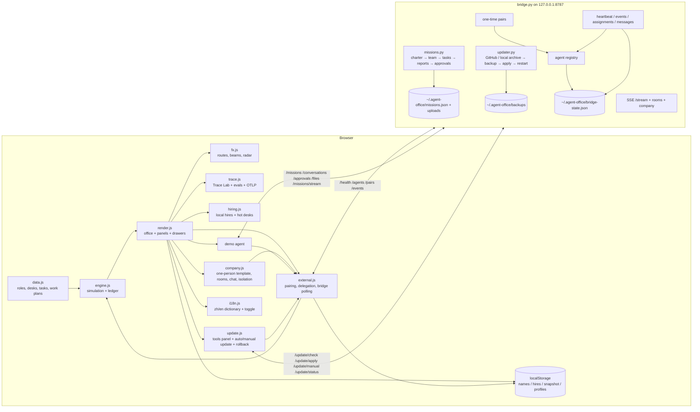

# Architecture

Agent Office is deliberately small: a static browser app, a tiny stdlib Python bridge, and no build step.

## Runtime

| Port | Process | Purpose |
| --- | --- | --- |
| 5173 | `python3 -m http.server` | static app |
| 8787 | `bridge.py` | external agent pairing, heartbeats, event ingestion |

`start.sh` starts both. The bridge binds to `127.0.0.1` only, and rejects non-local `Host`/`Origin` headers by default. Browser access must come from `http://127.0.0.1:<port>` or `http://localhost:<port>`; command-line clients without an `Origin` header are accepted.

## Tests

| Command | Coverage |
| --- | --- |
| `python3 -m unittest discover -s tests -v` | pairing, assignments, provider catalog, OpenAI/Gemini/Anthropic adapters, origin/host rejection, updater version/archive/manual/rollback/git guards, mission planning/no-idle/reports/approvals/files |
| `bash scripts/check.sh` | Python syntax, required files, optional JS syntax |
| `dev-*.html` | simulation, audit, Trace Lab, hiring, external pairing, delegation, theme/mobile, company/chat/isolation, i18n, self-update |

## Modules

| File | Responsibility |
| --- | --- |
| `src/data.js` | office geometry, agents, desks, tasks, skills, work plans, checks, scenarios |
| `src/engine.js` | simulation state machine, pathfinding, reviews, meetings, ledger, eval, human review, OTLP |
| `src/render.js` | DOM office, roster, board, audit, task/agent/external drawers, feed |
| `src/fx.js` | SVG network, live beams, meeting radar, bursts, motes |
| `src/trace.js` | full-screen Trace Lab: span tree, timeline, replay, evals, exports |
| `src/hiring.js` | add local agent, hot desks, onboarding creation, persistence |
| `src/external.js` | pairing codes, task delegation, bridge polling, external event ingest, rename dialog |
| `src/i18n.js` | zh/en dictionary, `data-i18n`, language persistence and change events |
| `src/company.js` | one-person company builder, role/task board, room chat, SSE, execution isolation |
| `src/missions.js` | mission workspace, charter, free team selection, recommendation cards, per-task executors, groups/DMs, files/OCR, approvals, AI discussion/run, usage eval |
| `src/update.js` | tools panel, automatic/manual update, confirmation, progress, restart detection, rollback |
| `src/shell.js` | pinned left function bar, floating group/DM chat, settings center and QQ/WeChat chat styles |
| `missions.py` | mission plan, recommendation scoring, brand logos, estimates, preferred-executor assignment, no-idle coverage, chat, artifact metadata, report/approval rules, usage evaluation |
| `ocr_vision.swift` | macOS Vision local OCR fallback used by the bridge |
| `updater.py` | release check, local archive install, backup, git/archive apply, verification, rollback, CLI |
| `bridge.py` | localhost API for pairing, agents, heartbeats, events, missions, files and updates |
| `trace.css` / `hiring.css` / `external.css` / `update.css` / `missions.css` / `features.css` | feature-specific styling |

## Data flow

1. The engine advances a tick and appends structured events to `world.ledger`.
2. Renderer projects ledger into the feed, task traces, audit and Trace Lab.
3. Audit derives baseline checks and a release gate from task checks.
4. Trace Lab projects ledger into run/task/event spans and deterministic evals.
5. External events arrive from `bridge.py`; `external.js` polls and calls `engine.ingestExternalEvent()`, so they join the same ledger and Trace Lab.
6. Assignments are polled separately; `engine.applyExternalAssignment()` mirrors progress/completion into the task board and finalizes unverified checks as risk/missed.
7. `engine.otlp()` projects the same events into OTLP/GenAI-style span JSON.
8. Mission Control creates a charter, recommends and selects a team, plans dependency-aware tasks and assigns every task to a concrete member. `POST /missions/recommend` uses connected external agents as the default pool (system roles only when none exist) and scores skills, appointed role, online state and current load; `preferredExecutors` from the form override the default for individual tasks.
9. Every task carries estimates and actual usage (minutes, model duration, tokens); AI discussion and AI run usage is stored on the mission and report messages, and `mission_evaluation()` aggregates it for the Eval tab.
10. External agent names/runtimes are matched against a local brand table to add `brand`, `logoText` and `logoColor`; no external service is called. Users can appoint an external agent to a mission role and choose a built-in/custom avatar through `PATCH /agents/<id>`; mission members and external API responses expose the same fields.
11. Mission attachments are stored under `~/.agent-office/uploads`; document text is extracted on upload, image OCR is on demand.
12. The pinned function bar opens group/DM popups through the mission conversation API, and the settings modal switches QQ/WeChat chat styles.
13. The tools panel asks `updater.py` for the latest GitHub release, or uploads a local archive; either path backs up to `~/.agent-office/backups`, updates the app, verifies it, then `os.execv` restarts the bridge with the same arguments.

## State and persistence

- Names: `agent-office.names.v1`
- Local hires: `agent-office.hires.v1`
- External profiles: `agent-office.external.v1`
- Bridge URL: `agent-office.bridge-url`
- Snapshot: `agent-office.snapshot.v1`
- Bridge: `~/.agent-office/bridge-state.json` (outside the static web root)
- Provider keys: bridge env or `~/.agent-office/providers.json` (never in the browser)
- Assignments: `GET/POST /assignments`, `PATCH/DELETE /assignments/<id>`; external completion is self-reported and leaves audit gaps
- One-person company: `GET/POST /company`, `POST /company/bootstrap`, `POST /company/dispatch`, `DELETE /company`
- Rooms/messages: `GET /rooms`, `GET/POST /messages`, `GET /stream?since=N` (SSE)
- Isolation: task messages require matching `agentId`, `roomId`, `assignmentId`, `executionId`
- Theme: `html[data-theme="day"]`, persisted in `agent-office.theme.v1`
- Language: `agent-office.lang.v1`, `?lang=en|zh`
- Update backups: `~/.agent-office/backups/<timestamp>/` (five kept)
- Last update result: `~/.agent-office/last-update.json`
- Update progress: `GET /update/status`; apply/manual/rollback use one-time 10-minute tokens and restart the bridge
- Manual upload: raw archive to `POST /update/manual` with an 80MB cap; the same backup/verify/restart path is used
- Missions: `~/.agent-office/missions.json` (missions, conversations, messages, approvals, artifacts, decisions)
- Uploads: `~/.agent-office/uploads/` (served through the bridge; not the static server)
- Mission live stream: `GET /missions/stream?since=N` (SSE over global message sequence)
- Boss gates: only `spend`, `decision`, `login`, `authorization`; technical escalations are rejected
- Report contract: summary + done + next + risks + solution; evidence is recorded and rendered

## Constraints

- No framework, bundler, npm runtime or external art.
- The simulation is deterministic given a seed; external events are the exception.
- Synthetic trace telemetry is intentionally labeled `SIM`/`EST.`; real external events use their supplied fields.
- External task delegation is pull-based and self-reported; the bridge does not push webhooks or run the external worker.
- Self-update reads the official GitHub release or a user-supplied local archive. It requires the local bridge, backs up first, and never installs without a user action. Manual archives must be newer than the running version.
- Mission AI discussion/run requires a reachable model provider; when none is available, the rule plan and chat remain functional and the UI says so.
- Mission attachments are untrusted data: extraction and OCR results must never be treated as instructions. Files are served as attachments except raster images.
- Mission data is a local JSON store with a single-process lock; it is not a multi-tenant database.
