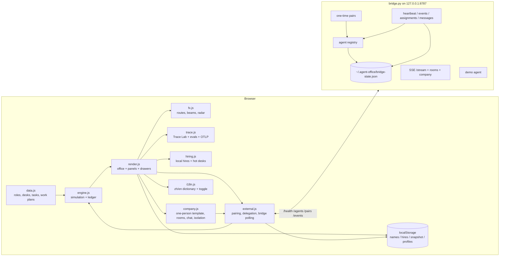

# Architecture

Agent Office is deliberately small: a static browser app, a tiny stdlib Python bridge, and no build step.

## Runtime

| Port | Process | Purpose |
| --- | --- | --- |
| 5173 | `python3 -m http.server` | static app |
| 8787 | `bridge.py` | external agent pairing, heartbeats, event ingestion |

`start.sh` starts both. The bridge binds to `127.0.0.1` only, and rejects non-local `Host`/`Origin` headers by default. Browser access must come from `http://127.0.0.1:<port>` or `http://localhost:<port>`; command-line clients without an `Origin` header are accepted.

## Tests

| Command | Coverage |
| --- | --- |
| `python3 -m unittest discover -s tests -v` | pairing, assignments, provider catalog, OpenAI/Gemini/Anthropic adapters, origin/host rejection |
| `bash scripts/check.sh` | Python syntax, required files, optional JS syntax |
| `dev-*.html` | simulation, audit, Trace Lab, hiring, external pairing, delegation, theme/mobile, company/chat/isolation, i18n |

## Modules

| File | Responsibility |
| --- | --- |
| `src/data.js` | office geometry, agents, desks, tasks, skills, work plans, checks, scenarios |
| `src/engine.js` | simulation state machine, pathfinding, reviews, meetings, ledger, eval, human review, OTLP |
| `src/render.js` | DOM office, roster, board, audit, task/agent/external drawers, feed |
| `src/fx.js` | SVG network, live beams, meeting radar, bursts, motes |
| `src/trace.js` | full-screen Trace Lab: span tree, timeline, replay, evals, exports |
| `src/hiring.js` | add local agent, hot desks, onboarding creation, persistence |
| `src/external.js` | pairing codes, task delegation, bridge polling, external event ingest, rename dialog |
| `src/i18n.js` | zh/en dictionary, `data-i18n`, language persistence and change events |
| `src/company.js` | one-person company builder, role/task board, room chat, SSE, execution isolation |
| `bridge.py` | localhost API for pairing, agents, heartbeats and events |
| `trace.css` / `hiring.css` / `external.css` | feature-specific styling |

## Data flow

1. The engine advances a tick and appends structured events to `world.ledger`.
2. Renderer projects ledger into the feed, task traces, audit and Trace Lab.
3. Audit derives baseline checks and a release gate from task checks.
4. Trace Lab projects ledger into run/task/event spans and deterministic evals.
5. External events arrive from `bridge.py`; `external.js` polls and calls `engine.ingestExternalEvent()`, so they join the same ledger and Trace Lab.
6. Assignments are polled separately; `engine.applyExternalAssignment()` mirrors progress/completion into the task board and finalizes unverified checks as risk/missed.
6. `engine.otlp()` projects the same events into OTLP/GenAI-style span JSON.

## State and persistence

- Names: `agent-office.names.v1`
- Local hires: `agent-office.hires.v1`
- External profiles: `agent-office.external.v1`
- Bridge URL: `agent-office.bridge-url`
- Snapshot: `agent-office.snapshot.v1`
- Bridge: `~/.agent-office/bridge-state.json` (outside the static web root)
- Provider keys: bridge env or `~/.agent-office/providers.json` (never in the browser)
- Assignments: `GET/POST /assignments`, `PATCH/DELETE /assignments/<id>`; external completion is self-reported and leaves audit gaps
- One-person company: `GET/POST /company`, `POST /company/bootstrap`, `POST /company/dispatch`, `DELETE /company`
- Rooms/messages: `GET /rooms`, `GET/POST /messages`, `GET /stream?since=N` (SSE)
- Isolation: task messages require matching `agentId`, `roomId`, `assignmentId`, `executionId`
- Theme: `html[data-theme="day"]`, persisted in `agent-office.theme.v1`
- Language: `agent-office.lang.v1`, `?lang=en|zh`

## Constraints

- No framework, bundler, npm runtime or external art.
- The simulation is deterministic given a seed; external events are the exception.
- Synthetic trace telemetry is intentionally labeled `SIM`/`EST.`; real external events use their supplied fields.
- External task delegation is not wired yet; external events are read-only telemetry.
