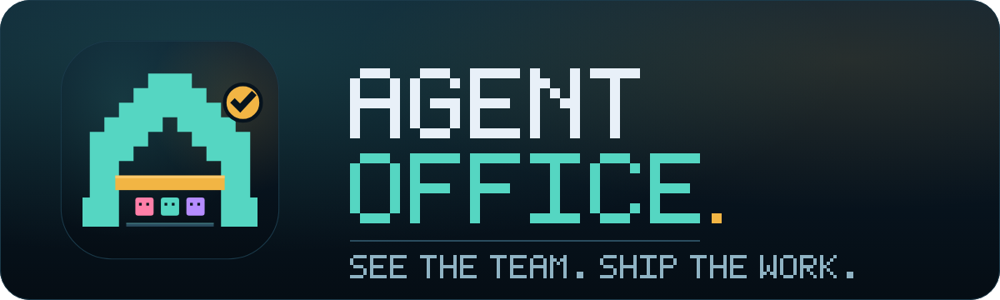
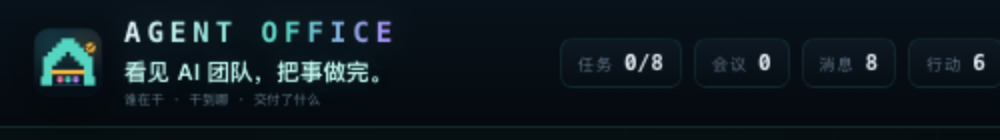
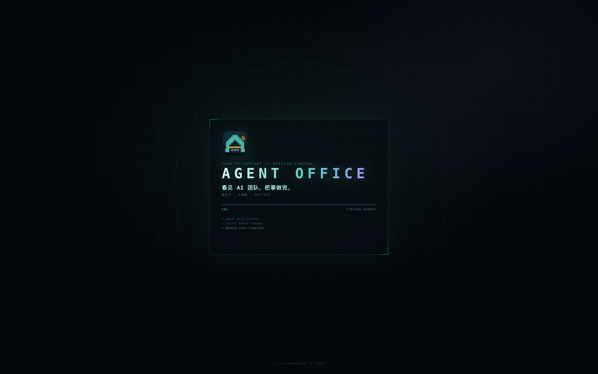
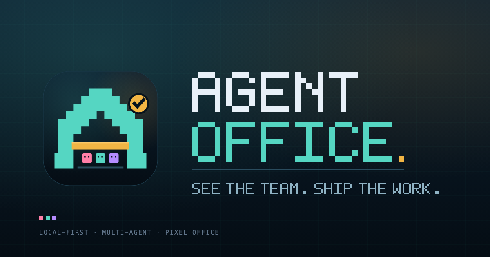

# Agent Office 品牌标识

> 版本：1.28.0 · 更新：2026-11-28
>
> 标识是产品的一部分，不是装饰。所有图形都打包在仓库内，运行时不请求任何外部图片、字体或 CDN。

## 一眼看懂

标识把四个产品事实画进一个像素图形里：

- **A**：Agent / 办公室的屋顶与双腿，也是产品名的首字母；
- **三个像素 Agent**：粉、青、紫三名团队成员，坐在办公桌前；
- **琥珀色横梁**：办公桌 / A 的横梁，同时是品牌最醒目的强调色；
- **完成勾**：右上角的琥珀徽章，代表「把事做完」，不是装饰性对勾。

整体是深海军蓝的 app tile + 阶梯像素屋顶，和产品里的像素办公室、Agent 精灵、状态灯保持同一套语言。

## 预览









品牌句：

> **看见 AI 团队，把事做完。**
>
> **SEE THE TEAM. SHIP THE WORK.**

## 文件与用途

| 文件 | 用途 |
| --- | --- |
| `assets/brand/agent-office-mark.svg` | 主标识（512×512）的规范源文件；header、boot、app icon 都从它派生 |
| `assets/brand/agent-office-favicon.svg` | 16×16 像素网格的简化 favicon；小尺寸下更清楚 |
| `favicon.svg` | `agent-office-favicon.svg` 的根目录副本，供旧链接 / GitHub Pages 使用 |
| `assets/brand/agent-office-logo.svg` | 横向 lockup（1200×360）：标识 + 像素字标 + 品牌句 |
| `assets/brand/agent-office-logo.png` | lockup 的 PNG 版本，供 README / 发布页使用 |
| `assets/brand/agent-office-social.svg` / `og-image.png` | 1200×630 社交分享图（Open Graph / Twitter Card） |
| `assets/brand/agent-office-app-icon.svg` | macOS 1024×1024 app icon 源文件（透明画布 + 10.5% 安全边距） |
| `assets/brand/AppIcon.icns` | 可直接放入 macOS `.app/Contents/Resources/` 的图标 |
| `assets/brand/icon.iconset/` | macOS iconset 的 10 个尺寸（16–1024） |
| `assets/brand/agent-office-touch.svg` / `apple-touch-icon.png` | 全出血 iOS 主屏图标（180×180） |
| `assets/brand/agent-office-maskable.svg` / `icon-maskable-512.png` | Android / PWA maskable 图标（80% 安全圆内） |
| `assets/brand/icon-192.png` / `icon-512.png` | PWA `any` 图标 |
| `assets/brand/favicon-16.png` / `favicon-32.png` / `favicon-48.png` / `favicon.ico` | 浏览器与 Windows 快捷方式 |
| `site.webmanifest` | PWA 名称、主题色与图标清单 |

## 颜色

| 名称 | 色值 | 用途 |
| --- | --- | --- |
| Office Navy | `#07131d` | tile 底色 / app 图标背景 |
| Signal Teal | `#55d6c2` | A 形屋顶、主品牌色 |
| Task Amber | `#f2b544` | 桌梁、完成勾、强调 |
| Agent Pink | `#ff7fa8` | 第一名 Agent |
| Agent Purple | `#b58cff` | 第三名 Agent |
| Ice White | `#e8f0f8` | 字标「AGENT」 |
| Muted Blue | `#8fb3c4` | 品牌句 |

绿色 `#7bd88f` 只用于「在线 / 完成」状态灯，不作为标识主色。

## 使用规则

- **不要拉伸、倾斜、旋转或改变比例。** 主标识是正方形；横向 lockup 保持 1200:360。
- **不要改色。** 需要单色版本时，用 `#e8f0f8` 或 `#07131d` 重新绘制，不要给现有图形套滤镜。
- **不要拆开元素。** 勾、三名 Agent、A 形屋顶是一个整体；不要把勾单独当 logo 使用。
- **最小尺寸**：完整标识 24px；favicon 用 16px 简化版；横向 lockup 最小宽度 480px。
- **留白**：标识四周至少留出 A 形屋顶高度的 12%。app icon 已内置 10.5% 安全边距。
- **背景**：优先深色底；在浅色底上使用完整 tile 版本，不要去掉 tile 只留 A（会失去对比度）。
- **品牌句**：中文「看见 AI 团队，把事做完。」；英文「SEE THE TEAM. SHIP THE WORK.」。不要改成「AI 助手」「聊天机器人」等泛化描述。

## 安装时如何被识别

应用在运行时完全本地，不需要构建；图标与元数据已提交到仓库：

1. **浏览器标签页**：`index.html` 优先加载 `agent-office-favicon.svg`，并提供 16/32 PNG 与 `favicon.ico` 回退。
2. **iOS 主屏**：`apple-touch-icon.png`（180×180，全出血，系统负责圆角）。
3. **Android / Chrome PWA**：`site.webmanifest` 提供 192/512 `any` 图标和 512 `maskable` 图标；`theme_color` 为 `#07131d`。`sw.js` 只做网络直通（不缓存），让浏览器可安装为 PWA，同时避免本地升级后看到旧界面。
4. **macOS App**：打包时把 `assets/brand/AppIcon.icns` 放到 `AgentOffice.app/Contents/Resources/AppIcon.icns`，并确保 `Info.plist` 的 `CFBundleIconFile` / `CFBundleIconName` 为 `AppIcon`。
5. **社交分享**：`og:image` / `twitter:image` 指向 `assets/brand/og-image.png`。
6. **README / GitHub**：使用 `assets/brand/agent-office-logo.svg`（或 PNG）。

### 更新本机已安装的 macOS 图标

仓库不自动修改 `/Applications`，因为这会改动用户已安装的 app bundle 和签名。使用显式脚本：

```bash
./scripts/install-macos-icon.sh
# 或指定其他 app bundle
./scripts/install-macos-icon.sh /path/to/AgentOffice.app
```

Chromium 系 app 的 `Assets.car` 里可能仍带一个 `AppIcon` 资源，且 `Info.plist` 同时设置了 `CFBundleIconName=AppIcon`；只替换 `AppIcon.icns` 时 macOS 可能继续显示旧的 asset catalog 图标。脚本会把新图标写成唯一的 `AgentOfficeIcon.icns`，令 `CFBundleIconFile=AgentOfficeIcon`，删除 `CFBundleIconName`，然后做 ad-hoc 重签和 LaunchServices/Dock 刷新。

如果 app 是签名分发的，请把脚本中的 ad-hoc `codesign` 换成正式签名/公证流程，而不是只替换资源文件。GitHub 仓库的 **Social preview** 需要在仓库 Settings 中手动上传 `assets/brand/og-image.png`；REST API 不提供该设置。

## 重新生成位图

源文件是 SVG；PNG / ICNS / ICO 是提交进仓库的派生产物，普通用户不需要生成。维护者改了 SVG 后，在 macOS 上运行：

```bash
./scripts/build-icons.sh
```

依赖：macOS 自带的 `sips`、`iconutil`，以及本机 Chromium/Chrome（`scripts/render-svg.py` 会查找常见路径，也可用 `CHROME=/path/to/chrome` 指定）。脚本会重新生成：

- `assets/brand/` 下的 favicon、PWA、Apple touch、OG、lockup PNG；
- `assets/brand/icon.iconset/` 与 `AppIcon.icns`；
- `favicon.ico`；
- 根目录 `favicon.svg` 副本；
- `build/AppIcon.icns`（本地打包用，`build/` 本身不入库）。

运行时仍然零构建、零 Node 依赖。

## 验收

```bash
python3 -m unittest tests.test_branding -v
./scripts/check.sh
```

`tests/test_branding.py` 校验：所有安装面文件存在、PNG 尺寸、manifest 图标可解析、index 的 favicon/apple-touch/manifest/OG/Twitter 元数据、根 favicon 与规范源一致、SVG 不引用远程图片、ICNS/ICO 容器、iconset 尺寸与品牌色。浏览器里可打开 `index.html` 看 header / boot；`assets/brand/agent-office-logo.svg` 和 `og-image.png` 可直接预览。
