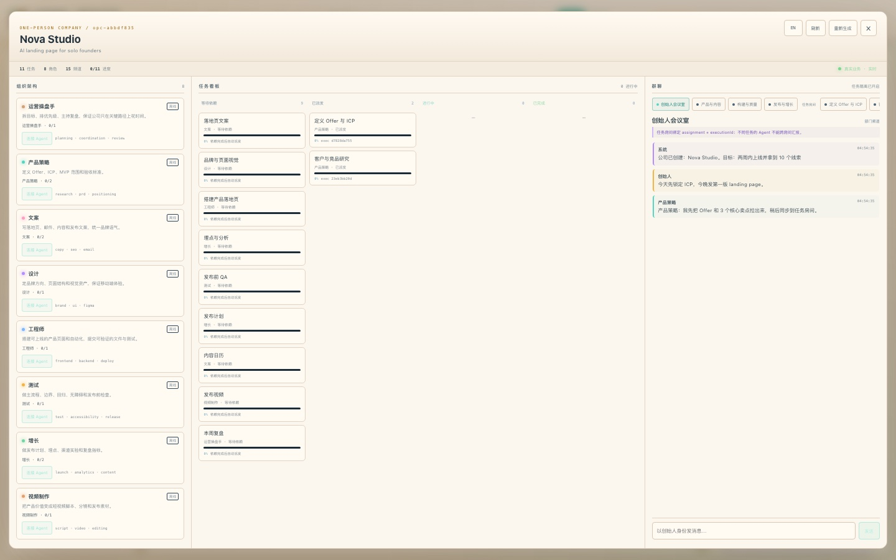

# One-person company OS

The one-person company workspace turns Agent Office from a simulation into a
real local business workflow:

- eight AI employee slots, each with a role, mission, skills and a pair code;
- eleven dependency-aware tasks generated from a concrete product/offer goal;
- four department channels plus one isolated room per task;
- automatic dispatch when a task's dependencies are complete;
- real-time group chat over SSE;
- assignment + execution isolation so a worker cannot report into another task's room;
- bilingual Chinese/English UI and generated company content.



## The template

Roles:

| Role | What it owns | Default tasks |
| --- | --- | --- |
| Chief of Staff | priorities, unblocking, weekly review | weekly review |
| Product Strategist | offer, ICP, research, acceptance criteria | offer, customer/competitor research |
| Copywriter | landing page, email, content voice | landing copy, content calendar |
| Designer | brand, page structure, mobile visual | brand/page direction |
| Engineer | build, responsive behavior, analytics hooks | landing page build |
| QA | flows, edge cases, accessibility, rollback | pre-release QA |
| Growth | launch, analytics, channels, metrics | analytics, launch plan |
| Video Producer | script, storyboard, launch assets | launch video |

Task graph:

```text
offer ─┬─> copy ─┬─> build ─┬─> analytics ─┐
       └─> design ┘         └─> qa ───────┤
                                           ├─> launch ─┬─> content
research ──────────────────────────────────┘            ├─> video
                                                        └─> weekly review
```

When `offer`, `copy` or `qa` completes, dependent tasks are dispatched
automatically. A task with unfinished dependencies stays `waiting` and is not
assignable.

## Pair a real worker

Each role starts as an unbound role slot (`opc-product`, `opc-copy`, …). In the
company view, click **Connect Agent** on a role. The bridge creates a role-bound
pairing code. Send the copied setup message to Claude Code, Codex, or another
worker. When it claims the code:

- the role slot becomes the worker's agent identity;
- the worker can poll `GET /assignments?agentId=opc-product`;
- no new random agent is created;
- existing queued assignments immediately become actionable.

The demo agent can be used for a local walkthrough, but it is not a substitute
for a real worker in production.

## Chat rooms and isolation

Every company has:

- `opc-room-founder`
- `opc-room-product`
- `opc-room-build`
- `opc-room-launch`
- `opc-task-<taskId>` for every generated task

Messages carry `roomId`, `taskId`, `assignmentId` and `executionId`. A task room
message from a worker is accepted only if all of these match the assignment:

```http
POST /messages
{
  "agentId": "opc-product",
  "roomId": "opc-task-t1",
  "assignmentId": "asg-...",
  "executionId": "exec-...",
  "content": "Offer draft is ready."
}
```

The bridge rejects:

- a worker posting to another task's room;
- an executionId from a different assignment;
- a worker posting as another agent;
- an inactive/cancelled assignment.

This is what keeps one agent working on multiple tasks from reporting into the
wrong group. The same agent can hold two active assignments, but each has its
own room and execution context.

## Real-time chat

- `GET /stream?since=N` is a Server-Sent Events stream.
- Chat posts use `POST /messages`; the UI sends as founder.
- Worker messages are posted with the role's agent id and execution context.
- The browser uses `EventSource` and reconnects automatically.
- The company view also polls `/company` every few seconds for assignment/task
  state; chat itself is event-driven.

SSE is localhost-only and has no authentication, matching the bridge's security
model.

## API

```text
GET    /company
POST   /company/bootstrap     {name, product, goal, language, replace}
POST   /company/dispatch
DELETE /company
GET    /rooms
GET    /messages?roomId=&since=
POST   /messages
GET    /stream?since=
```

Assignment endpoints remain:

```text
GET   /assignments?agentId=
POST  /assignments
PATCH /assignments/<id>
DELETE /assignments/<id>
```

## Bilingual behavior

- The UI language toggle is in the top bar (`EN` / `中`) and the company header.
- `?lang=en` and `?lang=zh` deep links are available.
- The company builder generates role names, missions, task titles and briefs in
  the selected language.
- The top-level shell, task statuses, company OS, chat and controls are
  translated. Authored simulation dialogue and task content remain the original
  narrative content; they are treated as content, not UI chrome.

## What is real vs simulated

Real:

- company records, roles, tasks, dependencies, assignments, messages, task rooms;
- role pairing and worker identity;
- progress/completion/failure writeback;
- automatic dependency dispatch;
- audit gaps from self-reported completion;
- SSE chat and execution isolation.

Still simulated or not implemented:

- the in-office agent movement and narrative remain a demonstration layer;
- the bridge does not execute code, run tests or call worker endpoints;
- no budgets, billing or multi-tenant auth;
- the demo agent fakes progress for walkthroughs;
- worker evidence is self-reported until you connect real CI/test hooks.

## Reference patterns

This design borrows primitives, not implementations:

- role/task decomposition and acceptance criteria: agency-orchestrator and MetaGPT/ChatDev-style SOPs;
- one-person company role charters: AgentHub and Paperclip-style org charts;
- rooms, human-in-every-room and shared workspace: Agency.Huddle;
- assignment/execution isolation: actor/mailbox-style execution contexts adapted to a local bridge.

The implementation stays zero-dependency, local-first, and intentionally smaller
than those platforms.
