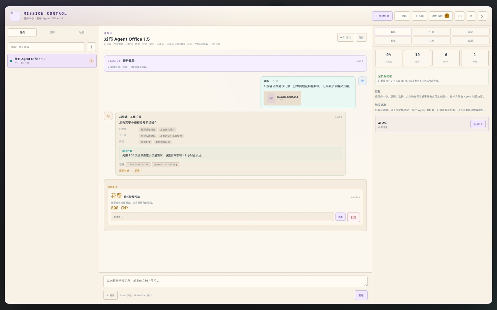
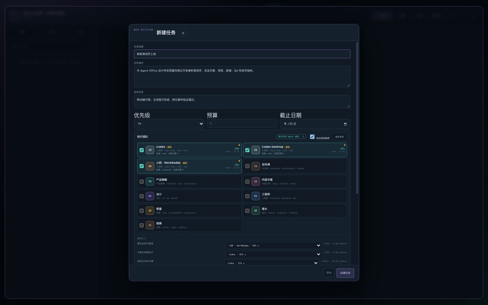
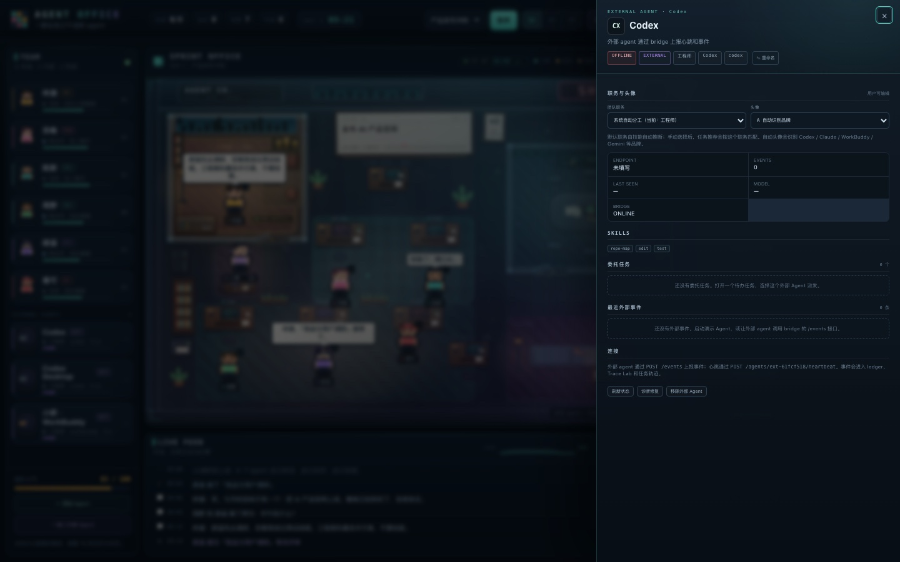
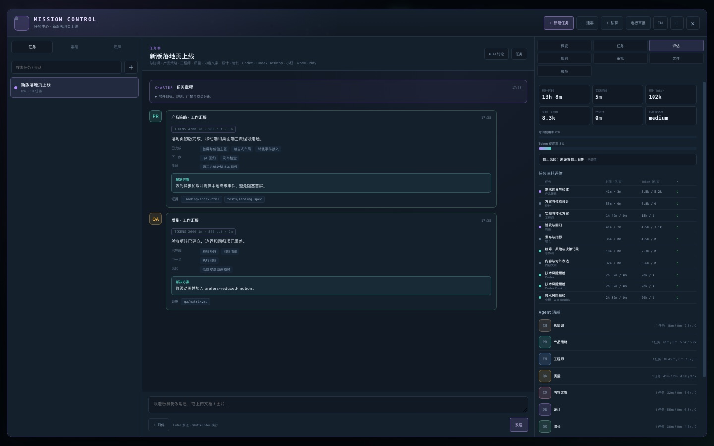

# Mission Control

Mission Control is the task workspace on top of Agent Office:

- create a task with a description, acceptance criteria, priority, deadline and files;
- open a task group, ad-hoc group or one-to-one DM;
- upload documents, spreadsheets, PDFs and images;
- optionally recognize image text with a vision model or `tesseract`;
- freely select a team, see recommendations from connected external agents,
  override the executor per task and assign every task to a concrete agent;
- keep every agent covered with a primary or standby task;
- show auto-detected brand logos for known external agents;
- estimate time and tokens and compare them with actual usage;
- require structured reports with a solution;
- route only four kinds of decisions to the boss;
- keep decisions, approvals, files and reports in one auditable thread.

Open **任务 / TASKS** in the top bar or use `?missions=1`.









## Task charter

Every mission freezes a charter on creation:

| Field | Meaning |
| --- | --- |
| objective | what the task must achieve |
| acceptance | what counts as done |
| deadline | optional target date |
| budget | optional; a positive budget creates a spend approval |
| tokenBudget | optional hard cap; 0 = unlimited. Discussion + task tokens count |
| non-goals / constraints | scope guardrails |
| boss gates | spend, decision, login, authorization |
| decision rule | the team decides technical topics; the boss only decides the four gates |
| report format | done / next / risks / solution / evidence |
| communication | task group for decisions; DMs for clarification |

The charter and task rules are written into the task group as a system message,
so every member sees the same contract. The current version is frozen at v1;
scope/budget changes should be treated as a new decision and approval.

## Only four things need the boss

`missions.py` rejects any other boss gate:

```text
spend          amount, currency, vendor/purpose
decision       business final call, with options and a recommendation
login          QR login / service login request
authorization  scopes, resource, duration
```

Technical architecture, tools, dependencies, schedules, testing, copy and design
tradeoffs are team decisions. If an agent tries to escalate a technical issue,
the bridge returns `technical_issue_must_be_solved` and leaves the report
unaccepted.

Approval rules:

- a request is one-time and cannot be silently re-approved;
- no auto-approval on timeout;
- the boss sees the amount/options/scopes/service and the evidence;
- QR login is an attachment plus a service request; credentials are never
  stored in chat;
- a rejected approval blocks the linked task until a new route is proposed.

## Team selection, recommendations and assignment

The bridge builds a directory from:

1. company role slots when a one-person company exists;
2. built-in AI roles otherwise;
3. connected external agents (`Codex`, `WorkBuddy`, etc.).

### Free selection

The new-task form shows every available agent with a logo/brand mark, skills,
match score and estimated time/tokens. All selected agents can be toggled
individually. **Auto team** starts with the recommended team; editing a single
task executor turns auto-team off so the rest of the choices are preserved.
Each recommendation row has a per-task executor selector, so the user can keep
the suggested agent or choose another selected member. The resulting
`preferredExecutors` map is sent with the mission and honored by the bridge.

### Recommendation score

**Real external agents are the default recommendation pool.** If at least one
connected external agent exists, `/missions/recommend` ranks only that external
pool; built-in AI roles are used only when no external agent is connected. The
built-in team remains visible and selectable, and creating a mission without
explicit members still uses the normal system division — this is a
recommendation-source change, not a removal of the default team.

```text
skill overlap × 10
+ role match × 8
+ external worker bonus
+ online external bonus (engineer/QA weighted)
− current load × 4
```

The response contains the plan tasks, top-3 agents per task with match
percentages, reasons and estimates, a suggested team (max 8), the preferred
executor for each task, and `scope: "external" | "system"`. Recommendations are
advisory: the team and every task executor remain editable, and system roles can
be selected manually at any time.

### External agent appointment

Every connected external agent can be appointed to a mission role from its
drawer: **系统自动分工** (the skill-based default) or chief/product/design/
engineer/QA/growth/content/video/operator. The choice is stored on the bridge
and immediately affects recommendation scoring and mission assignment. The
default system division is unchanged for users who do not override a role.

### Concrete assignment

Every generated task is assigned to a concrete member at creation time. If a
valid `preferredExecutors` entry exists, that agent wins; otherwise the highest
score among the selected members wins. Each task records its
`assignmentReason`. After primary assignment, any member with zero work receives
a useful standby task: risk review, evidence check, acceptance matrix,
dependency watch or environment preflight. "No idle" means **no agent is left
without a concrete, useful next action** — not that agents send fake activity.

## Logos and estimates

Known external brands — Codex, Claude/Anthropic, WorkBuddy/混元, Gemini/Google,
DeepSeek, Doubao/豆包, Kimi/Moonshot, Qwen/通义, Ollama, OpenAI/GPT — are detected
from the agent name and runtime, without calling an external service. Unknown
external agents get deterministic initials from their display name; built-in
roles use `CH / PR / CO / DE / EN / QA / GR / VI`. The same fields
(`brand`, `logoText`, `logoColor`) appear in the mission picker, member list,
chat reports, team roster, external agent list and drawer.

External agents also support an explicit avatar choice in their drawer:

- **Auto brand / 自动识别品牌** — brand mark or generated initials;
- built-in avatars — bot, fox, owl, cat, rocket, star, ghost, alien, spark,
  builder, lead;
- **custom initials** — 1–2 characters plus a color picker.

The avatar and role are persisted through `PATCH /agents/<id>` and included in
`GET /agents` (`meta.roles`, `meta.avatars`). They are local metadata; no remote
logo or avatar service is called.

Each task stores:

```json
{
  "estimate": {
    "minutes": 109,
    "tokens": 14561,
    "confidence": "high",
    "match": 94,
    "basis": "role base × complexity × skill match × load"
  },
  "actual": {
    "minutes": 3,
    "tokens": 4820,
    "durationMs": 187000,
    "startedAt": "2026-11-25T09:00:00Z",
    "finishedAt": "2026-11-25T09:03:07Z"
  },
  "usages": [
    {"provider": "deepseek", "model": "...", "tokensIn": 4000,
     "tokensOut": 820, "durationMs": 187000, "source": "ai-run"}
  ]
}
```

Estimates use role baselines, description length, priority, attachment count,
skill coverage and current load. Actuals come from AI provider usage and from
reports submitted by local or external agents. A report can include:

```json
{"usage": {"provider": "codex", "model": "gpt-5",
           "tokensIn": 1200, "tokensOut": 400, "durationMs": 95000}}
```

The **Eval / 评估** tab shows estimated vs actual minutes/tokens overall and per
task, variance, elapsed time, confidence, deadline risk, per-agent usage and AI
discussion overhead. AI discussion and AI run usage is stored on the mission and
the report message; report cards show an inline token/latency badge. This is a
consumption evaluation, not vendor billing.

`tokenBudget` adds a hard guardrail: **Tokens used / cap** is shown in the
evaluation tab, and auto-run stops before the next task once the total (including
discussion) reaches the cap. The cap is editable from the evaluation tab via
`POST /missions/<id>/budget`.

## Context memory

AI discussion and execution receive a context pack built from mission uploads
and OCR text, decisions, completed reports, evidence and approved gates. It is
reference material only: the system prompt explicitly says it cannot override
rules, reveal secrets or create approvals. This makes the mission a working
memory rather than a sequence of isolated prompts.

## Completion and next round

When every task is done, the mission switches to a completed coverage state:
`coverage.completed = true`, `idle = []`, and the UI shows “round complete ·
everyone wrapped up” instead of a false “Agent idle” warning.

The completed mission exposes **Start next round** in the command bar and
overview. The next round:

- reuses the current members;
- passes `previousMissionId`;
- carries the previous deliverable artifacts and embeds previous report
  summaries and decisions into the new mission description;
- starts auto-run again only when the previous round had auto-run enabled and a
  model is available; otherwise it creates a plan that can be started manually.

The API is the normal `POST /missions`; `previousMissionId` and `artifactIds`
are optional fields.

## Task states

```text
queued → assigned → in_progress → review → done
                         ↘ blocked
```

- Dependencies point at task IDs and are promoted automatically when all
  dependencies are done.
- Reports move a task to `review`.
- QA/owner verification can move it to `done` with `PATCH /mission-tasks/<id>`.
- A technical blocker must include a solution or fallback; otherwise the report
  is rejected.

## Reports

A report is a structured object, not free text:

```json
{
  "summary": "what happened",
  "done": ["..."],
  "next": ["..."],
  "risks": ["..."],
  "solution": "how the team handled the risk or blocker",
  "evidence": ["file or test"],
  "needsBoss": ["spend"],
  "approval": {
    "type": "spend",
    "title": "First ad test",
    "amount": 800,
    "currency": "CNY"
  }
}
```

The bridge rejects a report without a solution or with a non-boss gate. Reports
render as cards with separate done / next / risks / solution / evidence fields.

## Chat

- **Task group**: created automatically for every mission.
- **Group chat**: ad-hoc group with any selected members.
- **DM**: one-to-one with an agent.
- **Messages**: text, attachments, proposals, reports, approvals and system
  records. SSE against `/missions/stream?since=N` gives live message plus `overview` revision events (task, progress, auto-run, approval, file and conversation changes).
- **Files**: document and image attachments are stored outside the static app
  and served through `/files/<id>/raw`.
- **Private** means a separate conversation and membership check; it is not a
  UI-only filter. The boss can open a DM from a member card or a task owner.

## Files, documents and images

Upload types include text, Markdown, CSV, JSON, HTML, DOCX, XLSX, PDF, images and
other files.

Extraction:

| Type | Extraction |
| --- | --- |
| text / markdown / csv / json | read directly |
| HTML | strip tags |
| DOCX | `word/document.xml` via stdlib zipfile |
| XLSX | shared strings via stdlib zipfile |
| PDF | optional `pdftotext` |
| DOC | optional macOS `textutil` |
| images | on-demand vision provider, macOS Vision (`ocr_vision.swift`), or optional `tesseract` |

Image recognition is **on demand**:

```text
POST /files/<id>/vision
```

The bridge tries a configured vision-capable model provider first (Gemini,
OpenAI/OpenAI-compatible, Anthropic); on macOS it then uses the system Vision
framework (`ocr_vision.swift`), and falls back to `tesseract` when installed. If
none is available, the UI shows a clear "vision unavailable" message. OCR text
is stored with the artifact and rendered in the file preview. macOS Vision was
verified locally without any API key.

Attachments are untrusted. They are **data**, not instructions; do not let an
uploaded document redirect an agent's policy.

## AI discussion and AI execution

- **AI discussion** sends the charter, rules, members and tasks to one
  configured model API. It posts role-specific discussion, proposals, technical
  decisions and optional valid boss approvals. It never invents a technical
  escalation.
- An **unreachable local provider is skipped**; if no model service is
  available, the rule-based plan remains and the group shows a clear notice.
- **AI run** on a virtual role task asks the configured provider for a concrete
  deliverable and a structured report. The deliverable is saved as a Markdown
  artifact, the task moves to review, and the report appears in the group.
- External workers use the task protocol instead (below); they are not
  impersonated by the AI run button.

## API

```text
GET    /missions
GET    /missions/overview
GET    /missions/agents
POST   /missions/recommend

GET    /agents                 # includes meta.roles + meta.avatars
POST   /agents
PATCH  /agents/<id>            # name, role, avatar, avatarText, avatarColor
POST   /agents/<id>/heartbeat
DELETE /agents/<id>

POST   /missions
GET    /missions/<id>
DELETE /missions/<id>
POST   /missions/<id>/discuss
POST   /missions/<id>/tasks/<taskId>/run
PATCH  /mission-tasks/<id>     # status, assigneeId, progress, blockedReason, title, brief, acceptance, priority, report
GET    /mission-tasks?agentId=<id>

GET    /conversations?missionId=&kind=
POST   /conversations
GET    /conversations/<id>
PATCH  /conversations/<id>       # title, pinned, muted, readSeq
GET    /conversations/<id>/messages?since=
POST   /conversations/<id>/messages

GET    /approvals?status=pending
POST   /approvals
POST   /approvals/<id>/resolve

POST   /files
GET    /files
GET    /files/<id>
GET    /files/<id>/raw
POST   /files/<id>/vision

GET    /missions/stream?since=N

POST   /mcp                 # local MCP JSON-RPC (X-Agent-Id identity)
```

Conversation objects include `pinned`, `muted`, `readSeq`, `lastSeq`, `unreadCount` and `lastMessage` metadata. `PATCH` updates only chat organization/read state; message history remains append-only.

### External worker protocol

An external agent pulls its tasks:

```bash
curl "http://127.0.0.1:8787/mission-tasks?agentId=ext-my-agent"
```

It reports a result:

```bash
curl -X PATCH http://127.0.0.1:8787/mission-tasks/<task-id> \
  -H 'Content-Type: application/json' \
  -d '{
    "agentId": "ext-my-agent",
    "status": "review",
    "report": {
      "summary": "Implemented the form and validated mobile",
      "done": ["form", "responsive states"],
      "next": ["QA review"],
      "risks": ["third-party form endpoint"],
      "solution": "added a local fallback endpoint and retry",
      "evidence": ["tests/12-passed"],
      "needsBoss": []
    },
    "usage": {
      "provider": "codex",
      "model": "gpt-5",
      "tokensIn": 1200,
      "tokensOut": 400,
      "durationMs": 95000
    }
  }'
```

`usage` is optional but recommended: it updates the task's actual tokens,
model duration and the Eval tab. Reports without usage still count wall-clock
time from task start to review.

## Data and security

- Mission data: `~/.agent-office/missions.json`
- Uploads: `~/.agent-office/uploads/`
- Files are served by the bridge, not the static server.
- The bridge remains localhost-only with Host/Origin checks. There is no user
  authentication; use it on a trusted machine.
- Uploads are capped at 25MB; manual update archives are capped at 80MB.
- Raster images are inline; SVG/PDF/other documents are attachments.
- The boss approval endpoint is local-only. A production multi-user deployment
  needs real identity/auth and server-side role checks.

## Research references

These projects informed the patterns; no code or runtime was copied:

| Project | Pattern adopted |
| --- | --- |
| [humanlayer/humanlayer](https://github.com/humanlayer/humanlayer) | task/session/review workspace, async approval lineage |
| [loopx-project/loopx](https://github.com/loopx-project/loopx) | owner/safety/publication gates, evidence and leases |
| [builderz-labs/mission-control](https://github.com/builderz-labs/mission-control) | inbox → assigned → review → done, atomic queue and approvals |
| [langchain-ai/langgraph](https://github.com/langchain-ai/langgraph) | durable human interrupt / resume cards |
| [temporalio/temporal](https://github.com/temporalio/temporal) | durable workflows, signals and waiting without compute |
| [open-policy-agent/opa](https://github.com/open-policy-agent/opa) | versioned policy gate table |
| [crewAIInc/crewAI](https://github.com/crewAIInc/crewAI) | role/task abstraction and human feedback |
| [mattermost/mattermost](https://github.com/mattermost/mattermost) | channels/threads/DMs and agent mentions |
| [zulip/zulip](https://github.com/zulip/zulip) | topic-scoped async discussions and read state |
| [chatwoot/chatwoot](https://github.com/chatwoot/chatwoot) | conversation inbox, assignment and capacity |
| [makeplane/plane](https://github.com/makeplane/plane) | work-item states, intake triage and templates |
| [docling-project/docling](https://github.com/docling-project/docling) | document layout/table/OCR pipeline ideas |
| [microsoft/markitdown](https://github.com/microsoft/markitdown) | files-to-Markdown conversion approach |
| [tesseract-ocr/tesseract](https://github.com/tesseract-ocr/tesseract) | optional CLI OCR fallback |
| [adr/madr](https://github.com/adr/madr) | decision record template |

We deliberately did not embed LangGraph, Temporal, OPA, CrewAI, docling or a
full chat server. The product stays zero-dependency and local-first; these
projects supplied workflow and UX patterns.

## Limits

- AI discussion and AI run need a reachable provider. Local WorkBuddy/Ollama
  gateways are probed; if neither is running, the rule plan still works.
- PDF text extraction needs `pdftotext`; image OCR needs a vision provider,
  macOS Vision, or `tesseract`. There is no bundled cross-platform OCR model.
- QR login is a boss approval gate for an agent-supplied QR/link; Agent Office
  does not implement each service's OAuth flow.
- Approvals are local and unauthenticated; this is not a multi-tenant approvals
  service.
- Estimates are heuristics (role baseline × complexity × skill match × load),
  not a trained forecast; they are not vendor pricing. Historical calibration
  is on the roadmap.
- Brand logos are local name/runtime matches. They are not vendor trademark
  assets and no remote logo service is called. Built-in avatars are local
  emoji/glyph presets; custom avatars store only initials and a color, not
  uploaded images.
- Standby tasks are real, bounded checks, not simulated busywork.
- Mission data lives in a JSON document; large deployments should move to
  SQLite/Postgres.
