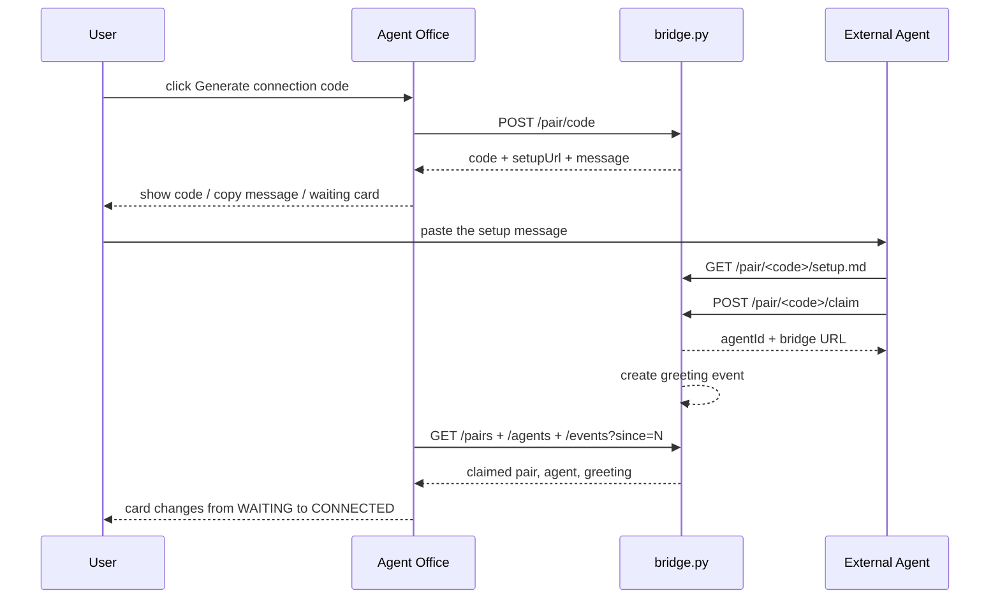

# External Agent Pairing

The add-agent flow is inspired by ClawChat's "copy a one-time connect code + setup instructions to an agent" model. The agent does the setup itself; the app does not ask the user to hand-fill a long connection form.



## Rules

- Code format: 8 chars from an unambiguous alphabet.
- Code is one-time, expires after 30 minutes.
- Every generation creates a new code; older codes remain valid until their own expiry.
- A claim creates an agent identity and a greeting event.
- The UI shows a `WAITING FOR AGENT` card while pending and a `CONNECTED` card after claim.
- There is no hard cap on the number of external agents.
- Each agent needs its own code and profile; do not reuse one code for two agents.

## API

```http
POST /pair/code
=> { pair, setupUrl, message }

GET /pair/<code>
GET /pair/<code>/setup.md
POST /pair/<code>/claim
  { name, runtime, endpoint, skills, note }
DELETE /pair/<code>          # cancel a pending/expired code; claimed codes return 409
GET /pairs
```

The bridge accepts only local Host and Origin headers. The app should be served from `http://127.0.0.1:5173` (or another localhost port). Direct `file://` usage is blocked unless `BRIDGE_ALLOW_FILE_ORIGIN=1` is set.

The setup document contains exact curl examples for claim, heartbeat, events, and assignment polling. Task delegation is described in [TASK_DELEGATION.md](TASK_DELEGATION.md).

## Diagnostics

The external agent drawer has a "diagnose" action. It copies a repair prompt containing the bridge URL, agentId, heartbeat endpoint and a safe test event. It does not delete the identity.

## Security

- The bridge is loopback-only and has no auth/TLS.
- A connect code is like an invite, not a password. Do not post it publicly.
- The setup URL contains the code; treat the copied message as sensitive until claimed.
- Real agent credentials stay in the external agent process, never in the browser.
