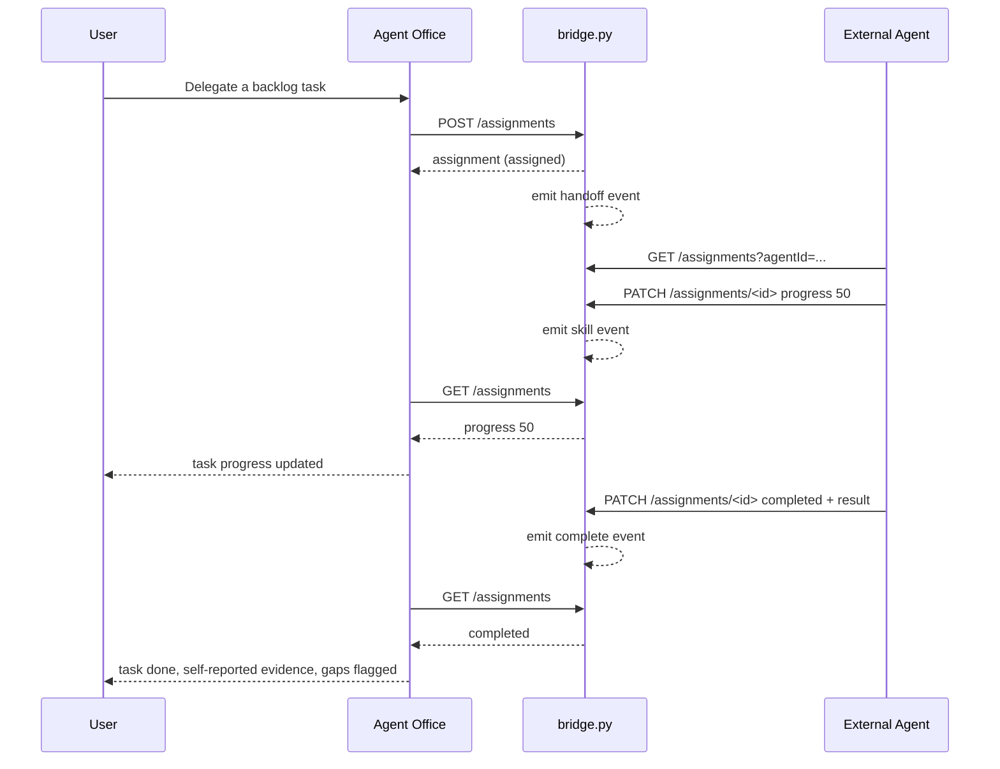

# External task delegation

Agent Office can hand a task from the sprint board to an external agent, receive
progress and completion events through the local bridge, and write the result
back into the simulation.

The external agent remains a separate process. The bridge is the source of truth
for the assignment; the browser mirrors it into the task board and audit view.



## Rules

- Only a `backlog` task can be delegated; all dependencies must be done.
- An assignment is scoped to a scenario and, when provided, a `runId`.
- Statuses: `assigned` → `in_progress` → `completed` / `failed` / `cancelled`.
- `progress` is an integer from 0 to 100.
- `completed` forces progress to 100 and stores `result`, `evidence` and
  `completedAt`.
- A terminal assignment (`completed`, `failed`, `cancelled`) cannot change to
  another terminal state.
- External completion is **self-reported**. The task becomes `done`, but
  uncovered high-severity checks become `risk` and the rest become `missed`.
  The release gate and audit keep those gaps.
- There is no local review by an internal agent for external completion; the
  ledger records `外部完成 · 未本地评审`.
- The demo agent automatically advances its assignments every ~2.4 seconds so
  the flow can be demonstrated without a separate agent process.
- Provider-managed model API agents are excluded from delegation. They are
  one-shot chat adapters and do not poll assignments; use Claude Code, Codex,
  the demo agent, or another worker process.

## UI flow

1. Start the bridge: `./start.sh`.
2. Connect an external agent (pairing code or model API).
3. Open a **backlog** task from the sprint board.
4. Under **委托外部 Agent**, choose the agent and optionally edit the brief.
5. Click **派发任务**.
6. The task moves to **进行中**, with an `EXT` marker.
7. The external agent polls assignments and reports progress/completion.
8. When completed, the task moves to **已完成** with a self-report warning.
9. Open **AUDIT** or Trace Lab to inspect the evidence and gaps.

## API

### Create an assignment

```http
POST /assignments
Content-Type: application/json

{
  "agentId": "ext-my-agent",
  "taskId": "t4",
  "title": "首页 Hero 与导航",
  "scenarioId": "launch",
  "runId": "optional-run-id",
  "brief": "Implement the hero and verify responsive states."
}
```

Response:

```json
{
  "ok": true,
  "assignment": {
    "id": "asg-1a2b3c4d",
    "agentId": "ext-my-agent",
    "agentName": "My Agent",
    "taskId": "t4",
    "taskTitle": "首页 Hero 与导航",
    "status": "assigned",
    "progress": 0,
    "result": "",
    "evidence": [],
    "createdAt": "2026-11-25T03:00:00Z",
    "updatedAt": "2026-11-25T03:00:00Z"
  }
}
```

### Poll assignments

```http
GET /assignments?agentId=ext-my-agent
GET /assignments?status=in_progress
```

### Report progress or completion

```http
PATCH /assignments/asg-1a2b3c4d
Content-Type: application/json

{
  "status": "in_progress",
  "progress": 50,
  "result": "Hero and navigation implemented; running tests."
}
```

Completion:

```http
PATCH /assignments/asg-1a2b3c4d
Content-Type: application/json

{
  "status": "completed",
  "progress": 100,
  "result": "Typecheck and 12 unit tests passed.",
  "evidence": ["tests/12-passed", "run://staging"]
}
```

Failure:

```http
PATCH /assignments/asg-1a2b3c4d
Content-Type: application/json

{
  "status": "failed",
  "result": "Blocked by missing staging credentials."
}
```

### Cancel

```http
DELETE /assignments/asg-1a2b3c4d
```

Cancels an active assignment and returns the task to `backlog`.

## Events

| Action | Bridge event kind | Ledger result |
| --- | --- | --- |
| create assignment | `handoff` | delegation trace + claim |
| progress | `skill` | progress event in Trace |
| completed | `complete` | completion event + self-report review marker |
| failed | `risk` | blocked task / risk |
| cancelled | `risk` | task returns to backlog |

The bridge response `lastEventId` points at the emitted event; the browser also
polls `GET /events?since=N`, so the ledger and OTLP export receive the same
telemetry.

## Test coverage

- `python3 -m unittest discover -s tests -v` covers create, list, progress,
  completion, invalid transitions, cancellation and unknown agents.
- `dev-delegation.html` covers the UI: reset, delegate, progress, completion,
  self-report warning, audit gaps and cleanup.
- `dev-external.html` covers pairing, providers, rename and existing external
  agent flows with a baseline-aware assertion.

## Limits

- Assignments are pulled by the external agent; the bridge does not push a
  webhook to the agent endpoint.
- There is no auth/TLS; keep the bridge on localhost.
- The bridge does not validate code, run tests or read a repository. Evidence
  strings are self-reported.
- External completion bypasses local review by design; audit gaps remain.
- Assignment progress is mirrored into the current browser run. A scenario reset
  with a new `runId` does not apply old assignments.
